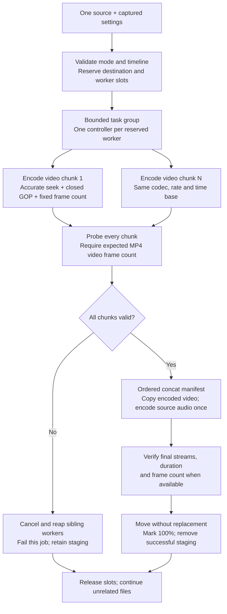

# Parallel chunks for one video

Parallel chunks are an optional way to spread one large video's software encoding across several FFmpeg processes. They are **off by default**: FFmpeg already supports multithreaded encoding, and splitting a file can be slower. File size alone does not predict the benefit. See the measured comparison below before assuming a 3 GB input will convert faster.

## Controls and workflow

1. Choose an MP4, MKV or MOV output and the `libx264` or `libx265` video encoder.
2. In **Video**, enable **Convert this file in parallel chunks**. Choose up to 2–8 workers and a target chunk length of 1–3600 seconds. Defaults are four workers and 120 seconds.
3. Set the queue's **Worker slots** budget. For one file with four chunk workers, choose at least four slots. Jobs and chunks share this budget; inspections still have their separate two-slot limit.
4. Apply the settings to selected pending jobs, then start the queue. The row shows overall progress. Expand **Chunks** to see each segment's progress and verified/completed state.
5. The job moves through encoding, joining/continuous audio encoding, final verification and commit. It reaches 100% only after a verified final file is committed.

Each job captures the available worker allocation when it starts. For example, a file requesting four workers may receive two if other jobs occupy the other slots. It does not expand its pool later. Lowering the queue limit changes future launches. Paused jobs retain their full reservation. Stop queue prevents new files from starting; an already active file continues its complete chunk workflow.

The progress bar uses duration-weighted chunk progress for the first 85%, joining/audio for the next 13%, and reserves the remainder for final verification/commit. It is a stage estimate, not a measurement of elapsed work. During chunk encoding, ETA estimates remaining video encoding only; final muxing/audio and verification take additional time. Speed/FPS aggregate currently encoding chunks.

## Supported inputs and settings

Use this mode with local, seekable videos with reliable duration and regular frame timing. The mode chooses the selected video stream's detected frame rate unless a numeric/rational output rate is supplied, and produces constant-frame-rate output. Supported rates are 1–240 fps, including `30000/1001`. Trim start rounds forward to an output-frame boundary; duration rounds down to complete output frames. Chunk lengths also round down to whole frames. A short file may produce one chunk.

| Supported | Use standard mode instead |
| --- | --- |
| H.264 (`libx264`), HEVC (`libx265`) | Video stream copy, hardware encoders, VP9/AV1 and other video encoders |
| MP4, MOV, MKV final output | Audio-only outputs and other containers |
| Scaling, CRF/bitrate/speed settings, selected video stream | Deinterlacing, custom video filters and expert argument arrays |
| One continuous audio encode; mute; selected/all audio tracks; audio processing | Audio stream copy and subtitles |
| Global metadata and source chapters through the final source input | Sources with a significant video/container start-time offset |

Clearly inconsistent average/nominal frame rates and significant video start offsets are rejected before encoding. These metadata checks cannot prove a whole source is constant-rate or free of timestamp discontinuities. Use standard mode for VFR recordings, unusual edit lists, discontinuous timestamps, poorly indexed or damaged media. Constant-rate conversion can change frame selection relative to the source's original timing; frame-perfect preservation of arbitrary VFR sources is not promised.

The planner limits each file to 4,096 chunks. Applying chunk mode, duplicating a chunked job or retrying it refreshes input metadata, including old saved probes that lack frame/timestamp fields. Explicit **Expert → Threads** settings apply per worker. With automatic threads, a chunk worker gets a CPU-count/pool-size hint; x265 also gets bounded native pool/frame-thread hints. These hints are not a global OS thread limit. Multiple files, decoding and native codec internals can still oversubscribe cores.

## Execution and output safety



`ChunkPlanner` creates video-only MP4 segments inside the existing job-owned destination-volume staging directory. Seeking occurs before input decoding, with a small rounding allowance at frame boundaries. Each chunk has a closed GOP and an explicit frame count. Generated files use controlled relative names such as `video-00000.mp4`; the concat demuxer keeps safe-path checking enabled. No shell is used.

All chunks must succeed and match their expected frame counts before joining. The manifest specifies each chunk's exact frame-derived duration. The final FFmpeg process stream-copies concatenated video and reads the original source once for audio, metadata and chapters. Encoding audio continuously avoids introducing an encoder delay/padding boundary at every video segment. Final verification requires video, a matching duration within a small frame/codec tolerance, and the exact frame count when the output container exposes it. This is structural verification, not a full decode or perceptual-quality test.

Chunk encoders reset rate control and GOP history, so lossy output size/quality can differ from a single encode using the same CRF. Chunks plus the joined file temporarily coexist: allow roughly the encoded video intermediates **plus** the complete output, in addition to the original source. The existing 100 MiB free-space minimum is only a starting check; it does not predict final size. Running out of space fails the job and retains partial files.

Pause/resume affects every current and future process in that file's worker pool. Probe timeouts exclude deliberate pause time. Cancel/quit cancels the parent task group, terminates/reaps children and prevents joining or committing after cancellation. A failed chunk fails the parent; missing chunks are never silently skipped. Other files continue independently. Retrying restarts the whole file and deletes only its own prior staging directory, including previous chunks. Completed-chunk resume is not implemented. Removing history does not delete media or staging files.

See FFmpeg's [accurate seeking and frame synchronization](https://ffmpeg.org/ffmpeg.html) and [concat demuxer contract](https://ffmpeg.org/ffmpeg-formats.html#concat) for the underlying tool behavior.

## Local telemetry

SQLite's existing `jobs.settings_json` records requested chunk settings. Actual worker allocation/segment progress is in queue snapshots and JSON recovery. A `chunk_plan` operation records actual allocation, segment count, frames, fps and attempt as JSON. During normal operation, the `operations` table records `chunk_total` per launched segment (including encode/probe/draining or failure), `chunk_verify` after successful chunk verification, and `chunk_join` after successful assembly. Segment indices in `detail` are zero-based. Join job UUID/session/timestamps to job-attempt history when analyzing retries.

`jobs.encoding_ms` covers the entire chunk-and-join phase, including intermediate verification; `verification_ms` remains final output probing. Worker CPU/memory/I/O totals sample every live controller PID, including chunk workers. Short-lived chunks/probes can finish between samples and have no measured CPU delta; zero in such a sample is not proof of zero CPU use. No SQLite schema migration was required.

## Measured tradeoff — November 5, 2026

Twelve Release scenarios converted one synthetic 30-second 1280×720 30 fps H.264/AAC file to H.264 CRF 23/medium. The queue budget was four, chunk length five seconds (six video chunks), and each configuration ran twice, interleaved by repetition. Invalid controls were disabled for this comparison; failure behavior is covered separately by integration tests. Host: Mac16,7, 14 logical CPUs, 48 GiB RAM. Fixture generation/building/rendering were outside timed batches. The GUI was closed; repeated source reads were warm-cache. Completion polling has 100 ms resolution.

| Thread hint per encoder | Standard, one process | Two chunk workers | Four chunk workers |
| --- | --- | --- | --- |
| Automatic | 1.45, 1.57 s | 2.48, 2.40 s | 2.41, 2.52 s |
| 2 threads | 5.22, 5.22 s | 3.86, 3.95 s | 3.02, 2.81 s |

All 12 outputs completed and passed validation with zero reported telemetry loss. On this source, chunking was **slower than the automatically threaded standard encode**. When constrained to two threads per encoder, four workers improved mean elapsed time from about 5.22 to 2.92 seconds (about 1.79×). Sampled combined memory peaked around 938 MiB with four automatic-thread chunk workers versus 466 MiB for automatic standard mode. Fast child lifetimes caused many CPU deltas to be missed; these runs do not establish peak CPU use or disk throughput.

This is evidence for keeping chunk mode optional, not a promise of speedup on large files. A long 3 GB video, 4K/HDR content, slow storage and prolonged memory pressure were **not** tested here. Measure a representative source with standard mode first. Reviewed path-free measurements and fixture metadata are in [Benchmarks/chunk-summary.json](Benchmarks/chunk-summary.json) and [Benchmarks/chunk-fixture.json](Benchmarks/chunk-fixture.json).

To repeat the comparison, put only the desired synthetic video in a fixture folder, then run:

```sh
python3 Scripts/run-stress-matrix.py \
  --fixtures build/ChunkBench/new/fixtures --output build/ChunkBench/new/results \
  --mode single-video --parallel 4 --threads 0 2 --chunk-workers 1 2 4 \
  --chunk-seconds 5 --repeat 2 --no-negative --tag chunk-compare
python3 Scripts/analyze-telemetry.py --prefix chunk-compare \
  --output build/ChunkBench/new/analysis
```

`--chunk-workers 1` selects standard mode in the benchmark tool. The application toggle selects standard versus chunk mode. `--codec libx265` and `--encoder-preset` support other comparisons. Use a unique tag per run; default SQLite retention can eventually prune older benchmark sessions.
