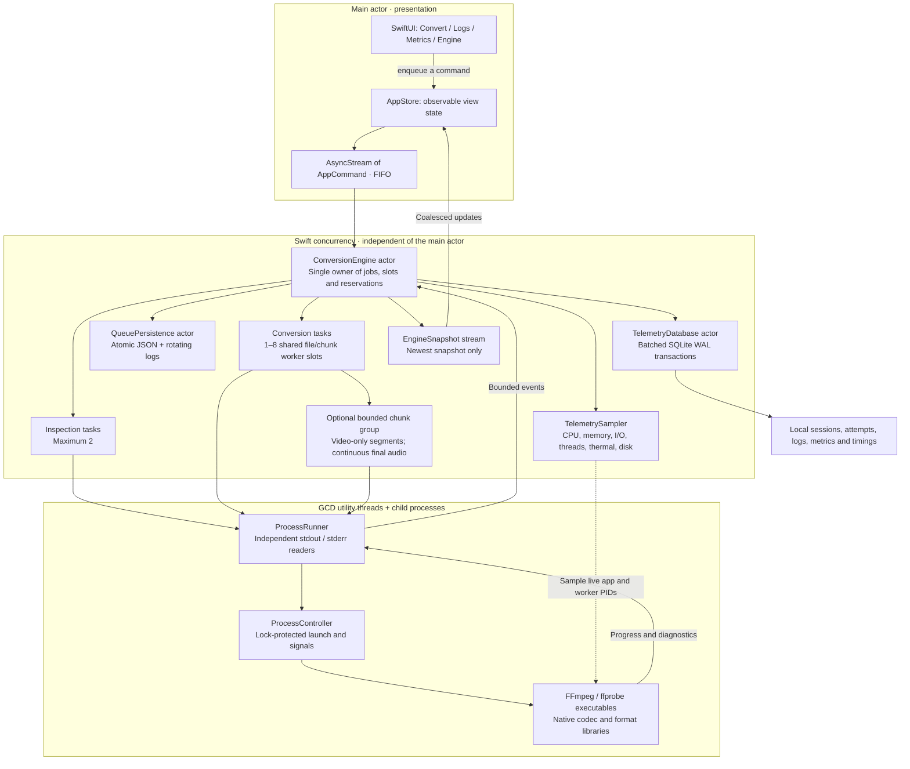
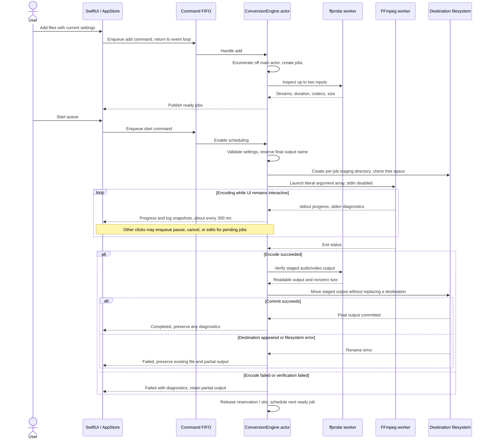
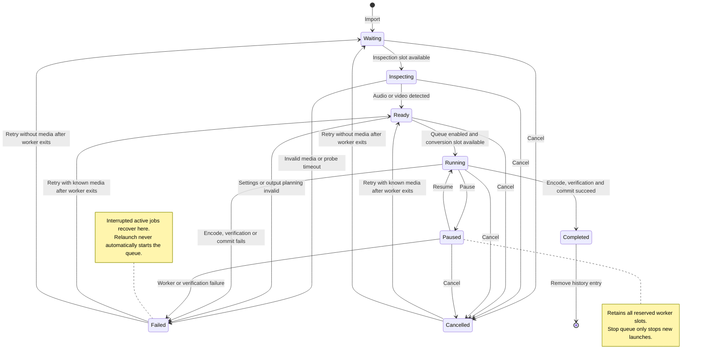
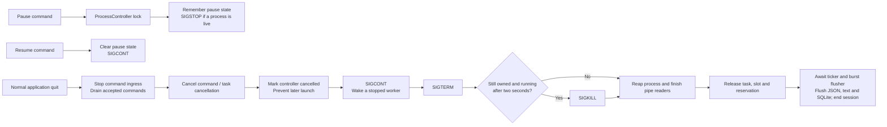
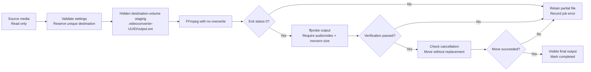
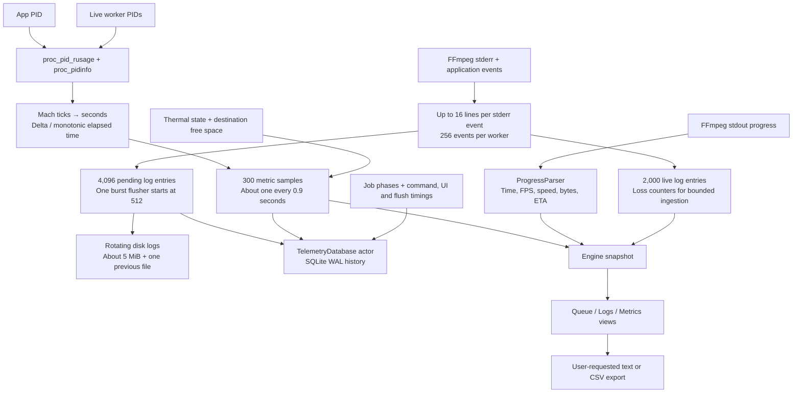

# System diagrams

These Mermaid diagrams render directly on GitHub. Their source lives in this document, alongside the implementation. For detailed invariants and file ownership, see [Architecture](ARCHITECTURE.md). For screen mockups and screenshots, see the [Visual guide](UI_GUIDE.md).

## Component and isolation boundaries

The SwiftUI process does not directly link the FFmpeg C API. The executable frontends load those libraries inside child processes. A native codec crash becomes a job error rather than a decoder crash inside the view process. The [parallel chunk workflow](CHUNKED_CONVERSION.md) has its own execution diagram and timing constraints.

## One click through a completed conversion

Verification checks the output container and streams; it does not decode every frame. A final destination created by another program causes a safe failure. Settings edits never mutate an already active job.

## Job lifecycle

Duplicating a job creates a separate UUID in Waiting or Ready, depending on whether media information is already available. Failed and cancelled rows can be edited before retry. Live task ownership prevents retry/removal from racing a dying worker.

## Pause, cancel, and graceful quit

A remembered pause applies even when requested before process launch. Every retry uses a fresh controller. A hard crash cannot execute graceful shutdown, and persisted PIDs are never used as authority to signal a process after relaunch.

## Managed output transaction

Retry discards only that same job's prior staging output before a new attempt. Removing queue rows leaves files untouched. Expert arguments remain trusted FFmpeg options and can introduce side files outside the managed output transaction.

## Real observability, bounded history

CPU uses 100% per logical core. Memory is physical footprint; disk rates are kernel-accounted physical I/O, so cache hits may report zero. GPU, network and power usage are not collected. No analytics service is configured.
