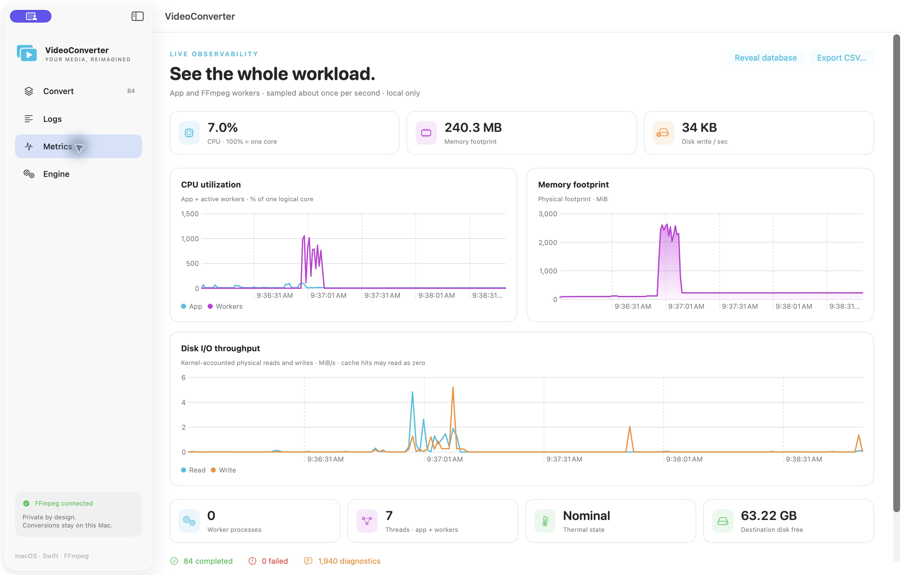

# Stress testing and SQLite analysis — November 5, 2026

The application completed **1,130 valid-media conversions with zero unexpected conversion failures** across 27 measured sessions: 25 headless engine scenarios and two native GUI sessions. The headless scenarios also included 25 invalid inputs, which failed independently, and 25 truncated inputs, which completed with diagnostics. Restored GUI history is excluded from these totals.

Encoding dominates this workload. SQLite was not the throughput bottleneck. Testing exposed unnecessary idle UI updates and substantial debug-log ingestion loss; both were reduced. A bounded stream can still drop events under overload, and GUI latency spikes remain a profiling target.

Reviewed evidence: [session summaries](Benchmarks/summary.json), [70 compression measurements](Benchmarks/compression-profiles.csv), [fixture sizes and SHA-256 hashes](Benchmarks/fixture-manifest.json). Raw databases, logs, commands containing local paths, and generated media remain local and are ignored by Git.

## Host, fixtures and method

The host was an Apple Silicon Mac16,7 with 14 logical CPUs and 48 GiB RAM, Xcode 27.1, Swift 6.4 and FFmpeg 8.0.1. All measured resource samples reported Nominal thermal state. Builds used Release optimization. Scenarios ran sequentially, with parallel workers inside each scenario; compilation and document rendering were kept outside timed batches. Repeated inputs and OS caches make these primarily warm-cache CPU/scheduling tests.

Five synthetic eight-second, 640×360, 30 fps videos include a 440 Hz, 48 kHz mono audio track. “1 MB” means a target of **1,000,000 bytes ±5%**, achieved by bitrate adjustment, without padding containers with unrelated data.

| Source | Video / audio | Actual bytes |
| --- | --- | ---: |
| MP4 | H.264 / AAC | 977,679 |
| MKV | HEVC / AAC | 978,608 |
| MOV | H.264 / AAC | 977,730 |
| WebM | VP9 / Opus | 983,608 |
| AVI | MPEG-4 / MP3 | 1,037,672 |

Each matrix combines all five sources with 14 profiles: H.264 CRF 18/23/32, HEVC CRF 22/30, VP9 CRF 24/36, MKV stream copy, MP3 64/192 kb/s, AAC/M4A 96/192 kb/s, FLAC and PCM WAV. It therefore executes 70 valid jobs, plus one invalid file and one half-truncated MP4. The latter uses best-effort recovery; successful structural probing does not prove all original frames survived.

`ConverterStress` uses the production `ConversionEngine`, including staging, output verification, final commit, JSON recovery, logs and SQLite. `batch_wall` starts at Start and ends when all jobs reach terminal states; fixture generation, tool discovery and initial inspection are outside that window. Completion polling has a 100 ms interval, so sub-second timings have limited resolution. The reported throughput uses 70 valid jobs divided by the batch window, which also includes processing the truncated control.

## Parallel throughput and resource cost

These four initial baseline scenarios ran once each with automatic encoder threads. SQLite instrumentation was already enabled. Later repeated and final checks below show run-to-run variation; this is not a statistically controlled scalability study.

| Parallel jobs | Batch seconds | Valid jobs/sec | Peak worker CPU | Peak app + worker footprint | Peak total threads |
| ---: | ---: | ---: | ---: | ---: | ---: |
| 1 | 61.40 | 1.14 | 325% | 315 MiB | 77 |
| 2 | 31.66 | 2.21 | 314% | 562 MiB | 149 |
| 4 | 19.23 | 3.64 | 566% | 1,188 MiB | 293 |
| 8 | 14.83 | 4.72 | 1,267% | 2,412 MiB | 581 |

Eight workers gave about **4.14×** the single-worker throughput, with about **7.7×** the sampled memory footprint. CPU uses 100% per logical core; 1,267% approaches the host's 1,400% capacity. Peaks are sampled, not lifetime maxima, and the first sample establishes CPU/I/O baselines.

After UI coalescing and log batching, a full eight-worker recheck completed 70/70 valid jobs in **15.34 seconds**, with zero reported telemetry loss, 1,179% peak worker CPU, 2,414 MiB peak combined footprint and 582 threads. Its event capacity was then increased from 128 to 256 for the final log-burst tests. The normal-workload timing is not evidence that log batching improves encoding speed.

### Thread oversubscription

An interleaved three-repeat comparison at eight parallel jobs measured:

| Encoder thread setting | Batch seconds, three runs | Mean seconds | Mean peak threads |
| --- | --- | ---: | ---: |
| Automatic (`0`) | 15.86, 15.53, 15.55 | 15.65 | 581 |
| `2` | 15.93, 15.66, 15.20 | 15.60 | 363 |

Setting two encoder threads reduced sampled thread counts by roughly **37%** without a meaningful throughput difference on these fixtures. This is an available tuning option, not a new universal default: codec internals, decoding, filters and native thread pools are not all governed by one thread option. Longer/high-resolution inputs may favor a different setting.

## Compression observations

The following are averages across the five sources in the 15.34-second recheck. Sizes use decimal bytes; ratios average each output's bytes divided by its own input's bytes. Encode times include concurrent contention, launch and pipe draining.

| Profile | Mean output bytes | Mean output/input ratio | Mean encode ms |
| --- | ---: | ---: | ---: |
| H.264 CRF 18 | 1,305,276 | 1.316 | 981 |
| H.264 CRF 23 | 901,567 | 0.909 | 1,032 |
| H.264 CRF 32 | 413,959 | 0.417 | 908 |
| HEVC CRF 22 | 1,070,261 | 1.078 | 2,310 |
| HEVC CRF 30 | 500,464 | 0.504 | 1,639 |
| VP9 CRF 24 | 1,311,721 | 1.325 | 6,281 |
| VP9 CRF 36 | 843,920 | 0.852 | 5,089 |
| MKV stream copy | 985,482 | 0.995 | 48 |
| MP3 64 kb/s | 64,678 | 0.065 | 65 |
| MP3 192 kb/s | 193,856 | 0.196 | 68 |
| AAC 96 kb/s | 98,934 | 0.100 | 103 |
| AAC 192 kb/s | 134,608 | 0.136 | 251 |
| FLAC | 441,362 | 0.446 | 71 |
| PCM WAV | 769,256 | 0.777 | 58 |

Higher CRFs reduced video size on these fixtures. CRF is not a fixed compression factor, and values are not equivalent between codecs. The simple mono sine track does not necessarily consume a requested AAC bitrate. Re-encoding already compressed media can grow a file; extracting audio changes the content being compared. Neither file size nor structural validation is a perceptual quality measurement. See [FFmpeg's codec documentation](https://ffmpeg.org/ffmpeg-codecs.html) for encoder-specific controls.

## What SQLite revealed

The single-worker valid-job phase totals were 58.62 seconds encoding, 2.49 seconds verification, 0.207 seconds initial inspection, and approximately 0.022 seconds combined planning/preparation/commit. Encoding accounts for **95.6%** of those measured phase totals. Duplicated profile jobs reuse media inspection. Verification is retained even though it is noticeable for very short remux/audio jobs; removing it would weaken output safety.

Single-worker SQLite transactions averaged **0.43 ms**, p95 **1.11 ms**, maximum **7.03 ms**. In the eight-worker recheck they averaged **0.59 ms**, p95 **1.31 ms**, maximum **4.45 ms**. These observations include commit time, but not unrelated UI rendering. `engine_tick` includes awaits and is not continuous occupancy of the engine actor. The final matrix's actor-ping p95 was **0.0037 ms**, with a **0.176 ms** maximum; this lightweight headless observation cannot establish GUI responsiveness.

The analyzed database passed `PRAGMA quick_check` and `PRAGMA foreign_key_check`. At the report snapshot it contained 27 sessions, 1,228 job-attempt rows (including 48 restored-history rows), 115,107 log rows, 676 metric samples and 10,997 operation rows in approximately **61.4 MiB**. Logs can temporarily exceed the 100,000-row retention target between pruning passes. An indexed query plan confirmed session/name operation lookups use `operations_session_name`. This small database did not expose an index or SQL contention bottleneck; a test separately verifies bounded failure/recovery under a competing writer lock.

Physical disk read rates were often close to zero after warming caches. These figures cannot establish storage throughput or rule out slow-volume bottlenecks. Synchronous final rename remains serialized on the engine actor, so a slow network filesystem is an untested risk.

### Debug logging was a real bottleneck

A separate workload remuxed four copies of each source at eight-worker concurrency with FFmpeg debug logging: 20 valid jobs plus the controls, completing in roughly 0.42 seconds. Each final run persisted about 15,100 log rows.

| Pipeline stage | Reported lost records/events |
| --- | --- |
| Original per-line delivery and periodic log flushing, one run | 11,107 |
| Batched stderr, burst flusher, 128 worker events, first three repeats | 70, 322, 256 |
| Same capacity, later checks | 0, 0, 0, 0, 32, 0, 0 |
| Final capacity of 256 events, three repeats | **0, 5, 0** |

Loss localization attributed the final five losses to the worker process stream, with none from the pending log buffer. Batching and asynchronous burst draining reduced observed loss by more than 99%, while keeping memory bounded and conversions independent. This is **not a lossless logging guarantee**. Count limits and overload behavior are documented in [TELEMETRY.md](TELEMETRY.md); final shutdown persists remaining pending logs rather than only the live-view ring.

Final burst transactions had p95 values of 9.92–11.49 ms and maxima of 10.19–11.88 ms. The slowest sampled actor ping was 0.812 ms. There were too few samples to characterize tail latency reliably. These sub-second workers exited before the 0.9-second resource sampler captured them, so the summary's zero worker CPU for burst sessions means **missed sampling**, not zero CPU consumption.

## Native GUI observations

Two real Release app sessions imported and converted 40 copied fixture files each using compact HEVC at eight-worker concurrency. All 80 jobs completed. The second session displayed 84 completed rows because it also restored the earlier 44 rows; the analyzer excludes restored history. Session labels `baseline-ui` and `optimized-ui` were assigned after identifying the captured application sessions.

The UI changes publish idle snapshots only when metrics/errors change, skip unchanged chart history, and avoid assigning identical selection/Dock values. To compare idle Metrics behavior, the analyzer starts three seconds after both the last new conversion and the first Metrics-tab event, then takes a 30-second window.

| Idle Metrics window | Before | After |
| --- | ---: | ---: |
| Resource samples | 31 | 32 |
| Mean application CPU, one core = 100% | 16.86% | 5.74% |
| Snapshot deliveries/sec | 3.17 | 1.07 |
| Snapshot delivery p95 | 0.427 ms | 0.377 ms |
| MainActor heartbeat extra delay p95 | 10.41 ms | 10.26 ms |

This suggests roughly **66% lower observed idle CPU** with similar idle heartbeat delay. The windows differ in queue history, chart history and prior interactions; this is an exploratory observation, not an isolated causal estimate or a frame-rate benchmark.

Across the entire interactive sessions, baseline/optimized snapshot-delivery p95 was **35.2/85.7 ms**, with maxima **281.6/726.3 ms**; heartbeat maxima were **413/677 ms**. The unmatched full-session latency results do **not** show a responsiveness improvement. Initial chart/layout work and bulk state changes need an Instruments trace on a controlled interaction replay before claiming smooth rendering under all load. Worker execution, log writing and SQL are outside MainActor, but that alone cannot guarantee a 60 fps interface.



## Reproduce and extend

```sh
python3 Scripts/make-stress-fixtures.py --output build/Stress/new-run/fixtures
python3 Scripts/run-stress-matrix.py \
  --fixtures build/Stress/new-run/fixtures --output build/Stress/new-run \
  --tag matrix --parallel 1 2 4 8 --threads 0
python3 Scripts/run-stress-matrix.py \
  --fixtures build/Stress/new-run/fixtures --output build/Stress/new-run \
  --tag thread-compare --parallel 8 --threads 0 2 --repeat 3
python3 Scripts/run-stress-matrix.py \
  --fixtures build/Stress/new-run/fixtures --output build/Stress/new-run \
  --tag debug-burst --parallel 8 --threads 0 --mode log-flood --repeat 3
python3 Scripts/analyze-telemetry.py --output build/Stress/new-run/analysis
```

The runner refuses to reuse a scenario output directory. Give each new run a distinct directory/tag. SQLite defaults to `~/Library/Application Support/VideoConverter/telemetry.sqlite`; `--database` selects an isolated alternative. The analysis script opens it read-only. Back up a live database through SQLite's backup API or `.backup`, then sanitize any export before sharing.

Before release, extend this work to long 1080p/4K media, varied real audio/content complexity, hardware encoders, large queues, cold-cache/slow destinations, prolonged runs and controlled UI replay. These 1 MB fixtures do not establish long-run memory stability, large-file throughput, exhaustive corruption recovery or perceptual quality. No test results from those workloads are claimed here.
