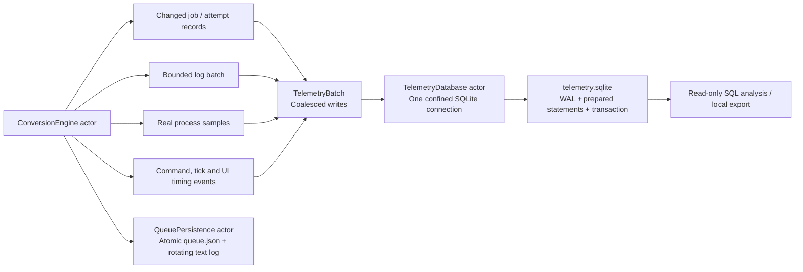

# Local SQLite telemetry

The application writes diagnostics to `~/Library/Application Support/VideoConverter/telemetry.sqlite`. The **Metrics → Reveal database** button opens its location in Finder. JSON queue recovery remains authoritative: a failed SQLite write reports an error and dropped-event count without cancelling conversions or replacing queue data.

No database, media, logs or raw metrics exports are committed to Git. The database includes local filenames, settings, FFmpeg command diagnostics and timing information. Inspect or sanitize exports before sharing them.

## Storage flow



Database work never runs on MainActor. The engine awaits batch writes on a separate actor, yielding while they execute so other queue commands can be processed. Progress does not generate an SQL write per frame. The GUI uses in-memory snapshots for charts and lists; it does not query SQLite during rendering.

## Tables and keys

| Table | Key / important fields | Meaning |
| --- | --- | --- |
| `sessions` | UUID `id`, label, start/end Unix time, CPU count, physical RAM | One engine lifetime, including each isolated benchmark scenario |
| `jobs` | `(session_id, id, attempt)`; input/output formats, settings JSON, state, byte counts and phase durations | Latest job state for each attempt; retry creates another attempt row |
| `logs` | `(session_id, id)`; timestamp, level, job UUID, message | Timestamped application and FFmpeg diagnostics; duplicate flushes are ignored |
| `metrics` | Session/time indexes; app/worker CPU and footprint, read/write rates, threads, worker count, thermal and disk status | The same real samples that feed the live Metrics screen |
| `operations` | Session/name/time indexes; operation name, duration in milliseconds, job UUID and detail | Responsiveness and storage observations, including benchmark configuration and total batch wall time |

`PRAGMA user_version=1` identifies the schema. Newer versions are rejected without recreating the file. Foreign keys cascade when old sessions are pruned. Statements bind values rather than interpolate filenames, log messages or settings into SQL.

### Job phase durations

All durations are monotonic elapsed milliseconds. Unix timestamps exist for joining events and presentation, not calculating phase durations.

- `inspection_ms`: original input probe, including probe process startup. Duplicates reuse detected media and have zero inspection time.
- `planning_ms`: setting validation, name selection and command construction.
- `preparation_ms`: destination/staging setup, previous partial cleanup and disk-space check.
- `encoding_ms`: FFmpeg launch through process exit and pipe/event draining. This includes launch and communication overhead; it is not encoder CPU time alone.
- `verification_ms`: output ffprobe process and structural stream/size checks.
- `commit_ms`: final move into the visible destination.
- `output_bytes`: verified output file size. Divide by `input_bytes` for the output/input size ratio. An audio-only or lossless export may legitimately be larger than its source.

`started_at` is when a conversion slot is allocated; its difference from `created_at` includes time waiting behind other jobs. Encoding, verification and commit times are preserved on failed/cancelled attempts where that phase was reached. Old JSON queues without the optional timings field still decode.

### Operation durations

| Name | Interpretation |
| --- | --- |
| `command` | Time inside actor command handling; `detail` names the action. Initialization includes tool detection and should be analyzed separately from ordinary clicks. |
| `engine_tick` | Wall time for a periodic tick, including awaits for persistence/SQLite; this is not continuous actor occupancy. |
| `database_flush` | Time spent in a prepared-statement batch transaction, including commit; it is separate from main-thread delivery. |
| `actor_ping` | Stress runner's measured wait for a lightweight actor snapshot; headless only, not a GUI frame-time measurement. |
| `ui_snapshot_delivery` | Time from published snapshot timestamp to application on MainActor; uses wall time for cross-boundary delivery observations. |
| `ui_heartbeat_lag` | Additional delay beyond a requested 100 ms MainActor wakeup; includes scheduler/system load. It is a responsiveness indicator, not a complete rendering trace. |
| `ui_tab` | Selected native tab, used to isolate comparable GUI observation windows. |
| `telemetry_health` | Cumulative diagnostic loss counts in JSON: total, worker process stream, and pending log buffer. Other batch/buffer losses contribute to the total. Counts are records/events, not bytes. |
| `scenario_config`, `batch_wall` | Reproducible benchmark parameters and conversion batch elapsed time; fixture generation/tool detection are outside the batch window. |

## Durability, contention and retention

SQLite runs in WAL mode with `synchronous=NORMAL`, a 100 ms busy timeout and automatic checkpointing at 1,000 WAL pages. Prepared statements are reused within each transaction. A rejected batch rolls back as a unit. Conversions continue and the telemetry error/drop count exposes that lost diagnostic batch. Normal shutdown flushes pending batches, timestamps the session's end and requests a passive checkpoint.

NORMAL mode favors diagnostic throughput over power-loss durability. A system crash or power loss can lose recent committed telemetry. This is not the queue recovery store. See [SQLite's WAL documentation](https://sqlite.org/wal.html) and [synchronous setting](https://sqlite.org/pragma.html#pragma_synchronous).

On open and after every 300 batches, retention removes sessions older than 30 days and finished sessions outside the latest 100. Each writer preserves its own session even when it runs longer than 30 days. Log, metric and operation tables retain at most 100,000 rows each after pruning. Jobs follow their sessions. Retention bounds historical rows over time; it is not an exact byte quota or immediate secure erasure, and SQLite may retain freed pages for reuse. Use one application writer per database; analysis tools open read-only.

In memory, each worker retains at most 256 process events; stderr events contain up to 16 lines with 8,192 characters per line. The engine retains 4,096 pending text/SQLite log entries, 4,096 changed job-attempt records, 300 pending metrics and 4,096 operation observations. One burst flush starts at 512 logs; periodic ticks drain smaller batches. The live UI ring remains 2,000 logs and 300 metrics. These are count limits rather than byte quotas; long Unicode lines can use substantial memory. Overflow discards older pending diagnostics and increments the loss counter. Trimming the intentionally limited live view or pruning retained history is not an ingestion loss.

The database file uses owner-only permissions. Do not copy only `telemetry.sqlite` while the app is running: a WAL file can hold newer data. Use SQLite's backup API or CLI `.backup`, or shut down all writers cleanly before copying the database with its required side files.

## Querying and analysis

```sh
sqlite3 "$HOME/Library/Application Support/VideoConverter/telemetry.sqlite"
```

Useful commands:

```sql
.headers on
.mode column
PRAGMA quick_check;
PRAGMA foreign_key_check;
SELECT label, datetime(started_at, 'unixepoch') AS started_utc,
       round(finished_at-started_at, 2) AS session_seconds FROM sessions;
SELECT s.label, j.state, count(*) AS jobs
  FROM jobs j JOIN sessions s ON s.id=j.session_id GROUP BY s.label,j.state;
SELECT s.label, o.name, count(*) AS samples,
       round(avg(o.duration_ms),3) AS mean_ms, round(max(o.duration_ms),3) AS max_ms
  FROM operations o JOIN sessions s ON s.id=o.session_id GROUP BY s.label,o.name;
SELECT output_format, video_codec, quality,
       round(avg(encoding_ms),1) AS encode_ms,
       round(avg(verification_ms),1) AS verify_ms,
       round(avg(1.0*output_bytes/NULLIF(input_bytes,0)),3) AS output_input_ratio
  FROM jobs WHERE state='completed' GROUP BY output_format,video_codec,quality;
```

For interpolated percentiles, source-level ratios and session comparisons:

```sh
python3 Scripts/analyze-telemetry.py \
  --output build/Stress/analysis --prefix stress
```

The analysis script opens the database read-only, checks integrity/foreign keys, and writes path-free `analysis.json` and `profiles.csv`. Sessions with no `batch_wall` event are shown without a batch throughput claim. For a stress run, inspect both expected negative controls and unexpected valid-input failures rather than combining them into one failure rate.
