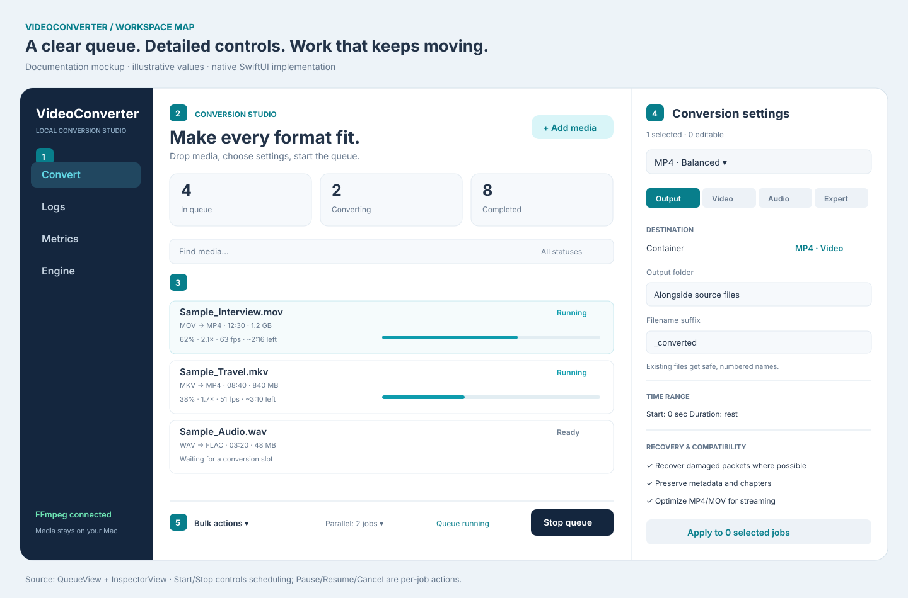
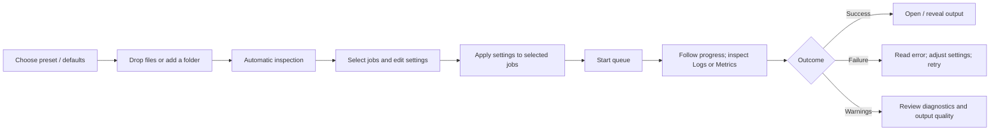
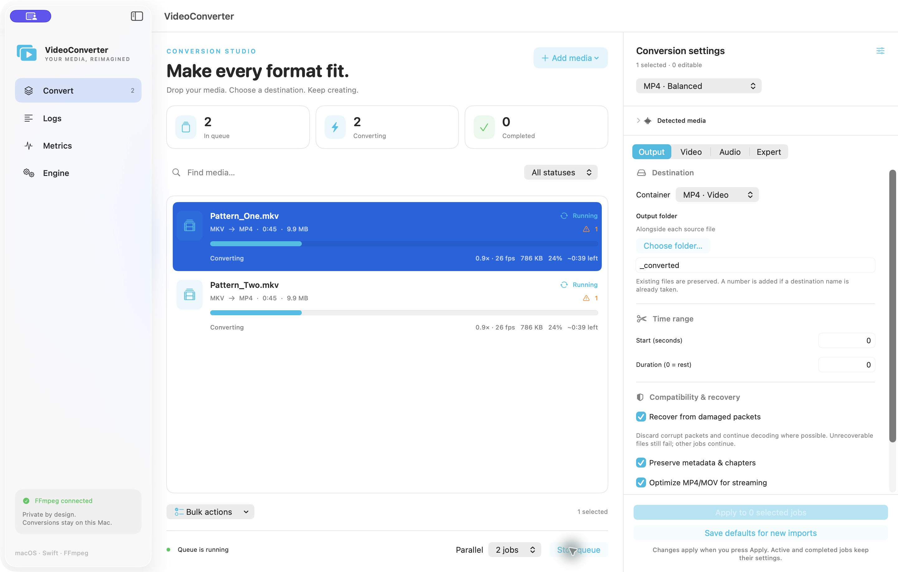
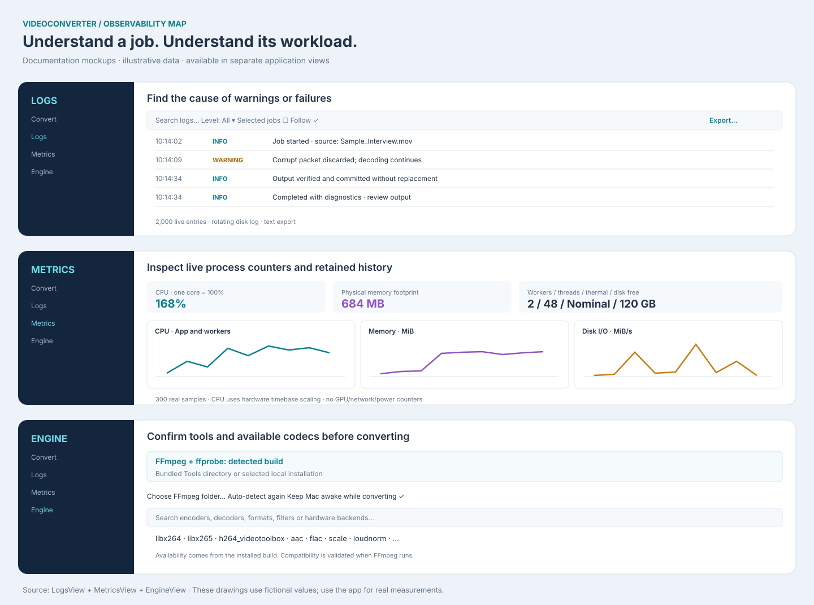
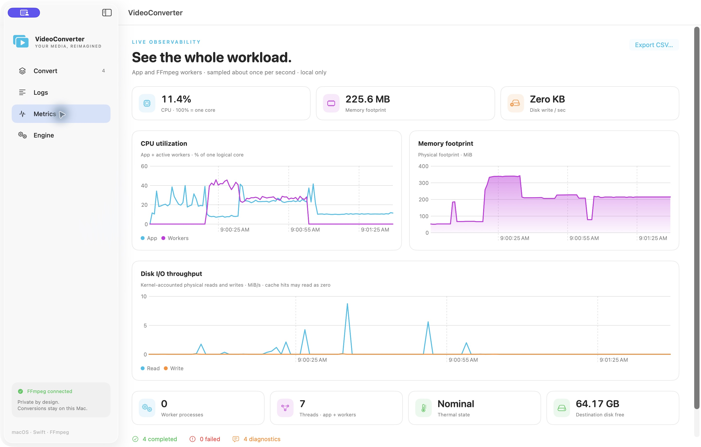

# Visual guide and editable mockups

The SVG drawings below explain the implemented layout with illustrative filenames, values and statuses. They are documentation mockups, not measured benchmarks or a promise that every option appears simultaneously. The PNG screenshots show the running application with generated sample media.

## Conversion workspace

| Region | What it is for | Main implementation |
| --- | --- | --- |
| 1 · Navigation | Switch among Convert, Logs, Metrics and Engine while jobs run | `ContentView.swift` |
| 2 · Queue summary | See pending work, active conversions and successful outputs | `QueueView.swift` |
| 3 · Media list | Select jobs, monitor progress, inspect warnings, use per-job context actions | `QueueView.swift` |
| 4 · Inspector | Edit captured settings through Output, Video, Audio and Expert categories | `InspectorView.swift` |
| 5 · Queue controls | Bulk actions, slot limit, start/stop scheduling | `QueueView.swift`, `ConversionEngine.swift` |

### From import to output

### Settings categories

| Category | Controls | Behavior to understand |
| --- | --- | --- |
| Output | Container, directory, suffix, trim, recovery, metadata, chapters, subtitles and fast start | Existing files are preserved with numbered names. Recovery is best-effort. |
| Video | Encoder, CRF/bitrate, speed preset, stream, size, frame rate, deinterlace and filter chain | Filters require re-encoding. Available encoders depend on the installed FFmpeg build. |
| Audio | Encoder, bitrate, sample rate, channels, mute, track selection, all tracks, normalization and filters | Audio-only containers use a selected or first audio track. Copy does not support resampling/filtering. |
| Expert | Thread hint, input/output JSON argument arrays, command preview and copy | Arguments are literal tokens. Managed input, overwrite and progress flags are reserved. |

Selecting one job loads a settings copy into the inspector. Press Apply to change eligible selected jobs. Editing the form does not mutate running or completed jobs. Save defaults affects future imports. Duplicate with current settings creates independent jobs, which is useful for producing several formats from the same input.

### Running application

The screenshot uses two synthetic test videos and realtime input pacing so progress is visible. The labels, warning counts and throughput are observations from that particular demonstration, not guaranteed encoding performance.

## Observability and backend setup

### Logs

Use search, severity, selected-job filtering and follow mode to investigate a conversion. FFmpeg stderr diagnostics remain visible when a job succeeds with warnings. Export produces a text file; clearing the view leaves the rotating disk logs intact.

The Logs panel in the editable mockup above uses fictional diagnostic messages. The development log screenshot is kept local because real command lines include machine-specific filesystem paths.

### Metrics

The CPU graph separates app and worker usage; memory reports physical footprint and disk graphs report kernel-accounted I/O rates. Threads, worker count, thermal state and available destination space add context. CSV export contains the retained samples, including separate app/worker CPU and memory fields.

Samples are retained in a 300-entry rolling history. One core at full use is 100%, so parallel work may exceed 100%. Short-lived workers may fall between samples. GPU, network and power counters are not implemented.

### Engine

Use Engine to confirm the exact FFmpeg/ffprobe location, choose an installed build, search detected capabilities and change the keep-awake policy. Detection checks bundled tools before common Homebrew/PATH locations. An encoder appearing in the capability list does not guarantee every hardware profile or container combination will work.

## Interaction rules

- File pickers are asynchronous; queue work and file scanning are outside MainActor.
- Buttons enqueue queue commands, with one consumer preserving command order.
- Start enables scheduling. Stop queue prevents new launches and leaves existing work running.
- Pause suspends a worker and retains its conversion slot. Resume continues it. Cancel resumes a stopped worker before termination.
- Bulk actions operate on selected rows. Retry/removal waits for a cancelled worker to finish exiting.
- Completion requires process success, a valid staged output and a successful final move. A progress report alone cannot mark a job completed.
- Saved queues restore history and interrupted-job failures, with scheduling stopped.

For implementation boundaries and message flow, see [System diagrams](DIAGRAMS.md). For manual checks and known limits, see [Testing](TESTING.md).

## Maintaining these visuals

Edit the SVG files directly as versioned text. They contain no scripts, external fonts or external images. Keep illustrative data clearly marked and align labels/actions with the current views. Capture new PNG screenshots only with disposable synthetic media; review screenshots and logs before publication. Avoid committing real user paths, media metadata, credentials, queue state or metrics exports.
