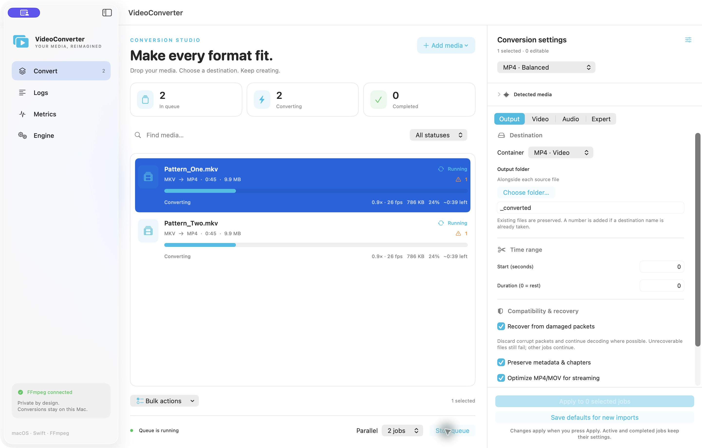

# VideoConverter for macOS

A native SwiftUI conversion studio with a responsive, actor-owned work queue. Convert video, extract or convert audio, remux streams, inspect media, process folders, and monitor FFmpeg workers without running conversion work on the main thread.

[Visual guide and mockups](Documentation/UI_GUIDE.md) · [Architecture diagrams](Documentation/DIAGRAMS.md) · [SQLite telemetry](Documentation/TELEMETRY.md) · [Stress-test results](Documentation/STRESS_RESULTS.md) · [Agent instructions](AGENTS.md)



## Open and run

1. Open **VideoConverter.xcodeproj** in Xcode.
2. Select the **VideoConverter** scheme and **My Mac**.
3. Press **Run**. Requires macOS 14+, Xcode with Swift 6, and FFmpeg/ffprobe.

The generated Xcode project is included; XcodeGen is only needed when regenerating it. FFmpeg binaries and libraries are not committed to this repository. The original development workspace has a local bundle in the ignored `Resources/Tools` directory; a fresh clone can use an installed FFmpeg build or create its own bundle with the supplied script. The app discovers bundled tools first, then Homebrew and PATH locations. You can choose another build in **Engine**.

To build from a clean checkout:

```sh
brew install ffmpeg xcodegen
git clone https://github.com/giridharmb/VideoConverter.git
cd VideoConverter
xcodegen generate
xcodebuild -project VideoConverter.xcodeproj -scheme VideoConverter \
  -configuration Debug -derivedDataPath build CODE_SIGNING_ALLOWED=NO build
open build/Build/Products/Debug/VideoConverter.app
```

Or run `zsh Scripts/build.sh`. Choose a signing team in Xcode for a signed development build.

## What it does

| Area | Features |
| --- | --- |
| Import | File and folder pickers, drag and drop, recursive folder scanning, duplicate detection, two parallel ffprobe inspections, stream/codec/duration/size/language detection |
| Formats | MP4, MKV, MOV, WebM, AVI; M4A, MP3, WAV, FLAC, Ogg, Opus, AAC |
| Presets | Balanced H.264, compact HEVC, Apple VideoToolbox, VP9 WebM, stream-copy MKV, MP3 extraction, lossless FLAC |
| Video | Custom encoder names, CRF, bitrate, encoding speed, scaling, frame rate, deinterlacing, filter chains, explicit stream selection |
| Audio | Custom encoder names, bitrate, sample rate, channels, mute, all tracks in video containers, explicit track selection, loudness normalization, filters |
| Output | Per-source or chosen output folder, filename suffix, collision-safe numbering, trim start/duration, metadata/chapters, subtitles, MP4 fast start |
| Queue | 1–8 conversion slots, independent inspection slots, per-job configuration snapshots, bulk apply/pause/resume/cancel/retry/remove/reorder/duplicate, saved queue and history, CSV report |
| Progress | Per-job progress, encoding speed, FPS, estimated remaining time, output byte count, Dock badge |
| Recovery | Damaged packet tolerance, independent job failures, input/output validation, retained partial files, safe restart after interruption |
| Logs | Separate tab, levels, search, selected-job filter, follow mode, text export, bounded memory, rotating text logs and persistent SQLite history |
| Metrics | Separate tab, real app/worker CPU and memory, I/O rates, threads, thermal state, disk space, live charts, CSV export and SQLite history |
| Performance | Sessions, retry attempts, phase timings, output byte ratios, UI heartbeat/delivery observations, release stress runner and read-only SQL analysis |
| Engine | Automatic executable discovery, version and searchable encoders/decoders/formats/filters/hardware acceleration; configurable keep-awake policy |
| Expert | JSON argument arrays before input and before output, literal argument execution, generated command review/copy |

## Conversion workflow

1. Choose a preset and defaults in the inspector, then add files or folders. Settings are captured for each new job. Non-media files produce individual inspection failures rather than stopping the batch.
2. Select one or more jobs. Review detected media, change the settings, and press **Apply to selected jobs**. Active and completed jobs are immutable. Failed and cancelled jobs can be edited before retrying.
3. Set the number of parallel jobs and start the queue. **Stop queue** stops new launches; running jobs continue. **Pause selected** suspends the FFmpeg process. Paused conversions keep their slot until resumed or cancelled.
4. Review diagnostics in **Logs** and resource use in **Metrics**. A successfully encoded file can still contain warnings; the app preserves them for review.
5. Open or reveal a job through its context menu. Export a queue report from **Bulk actions**.

To create several versions of one source, select it, configure the inspector, then choose **Bulk actions → Duplicate with current settings**. Import deduplication does not prevent explicit job duplication. Finished history can be cleared without deleting source, output, or partial files.

**Save defaults for new imports** persists the current settings between launches. Selecting a job loads its captured settings into the inspector. Changing a preset preserves your output folder and filename suffix. It does not silently change existing jobs.

## FFmpeg libraries and advanced options

The application uses FFmpeg's `libavcodec`, `libavformat`, `libavfilter`, `libavutil`, `libswresample`, and `libswscale` through the FFmpeg/ffprobe executable frontends. These libraries execute in isolated worker processes; they are **not linked into the SwiftUI process**. This gives broad FFmpeg option support, a structured progress protocol, process-level cancellation/pause, and decoder crash isolation without rebuilding FFmpeg's command-line orchestration in Swift.

The optional local bundle includes installed FFmpeg executables and their non-system dynamic library closure. To create it after cloning:

```sh
python3 Scripts/bundle-ffmpeg.py
xcodegen generate
zsh Scripts/build.sh
```

The bundler makes no downloads, rewrites dynamic library references to relative bundle paths, signs the copied Mach-O files ad hoc, and verifies both tools launch. It refuses to overwrite a nonempty bundle. Move an old `Resources/Tools` aside before recreating it. `manifest.json` records origins and source hashes; `ffmpeg-build.txt` records build configuration and licensing information. Bundles are specific to the architecture of their source binaries.

In **Expert**, each argument is one JSON string:

```json
["-g", "60", "-metadata", "title=My export"]
```

Put input options before input and encoding/muxing options before output. Options are passed directly to `Process.arguments`; no shell expansion or shell quoting takes place. Shell metacharacters remain literal. The app reserves input, overwrite, stdin, and progress control flags. Expert options are trusted FFmpeg configuration: they can override generated settings and can direct FFmpeg to write side files or access protocols. Review the generated command.

The graphical controls cover common conversion workflows. The expert argument fields expose additional options for **one local source and one managed output per job**. This is not a graphical editor for every FFmpeg command: multi-input composition, two-pass analysis, streaming servers, capture devices, and arbitrary multi-output filter graphs need a dedicated future workflow. Linkable FFmpeg option documentation is available in Engine/Expert.

Encoder and container compatibility depends on the installed build. Hardware support being listed does not guarantee a particular codec/profile/resolution will work on the current Mac. Unsupported combinations fail with FFmpeg's diagnostics and leave the remaining queue running. CRF is generated for common CRF-capable encoders; other custom encoders use their defaults unless configured explicitly. The speed preset control applies to x264/x265.

## Safety and recovery behavior

- Sources and existing destination files are never intentionally overwritten by generated commands. Names are reserved across parallel jobs. FFmpeg uses `-n`; the final rename also refuses an existing destination.
- Conversion writes into a hidden `.videoconverter-<job UUID>/output.<extension>` directory on the destination volume. FFmpeg must return success and ffprobe must recognize a nonempty audio/video output before it is moved to the visible destination. This is structural validation, not a full decode or perceptual quality guarantee.
- A collision introduced by another program before the final rename fails the job rather than overwriting that file. Retry allocates a fresh destination name.
- Failed/cancelled partial files remain in the hidden staging directory for diagnosis. Retrying that same job removes its previous partial file. Removing a queue entry does not delete files; remove unwanted staging directories in Finder after confirming their contents.
- A minimum 100 MiB free-space check runs before encoding. The app cannot predict final size; ENOSPC during encoding becomes a normal job failure.
- Corruption recovery uses `discardcorrupt`, `genpts`, and `ignore_err`. Damaged packets may still produce missing frames/audio or an unrecoverable error. A bad job never cancels the rest of the batch.
- Cancel resumes a suspended process, sends SIGTERM, and escalates to SIGKILL after two seconds if necessary. Inspection and output verification have a 60-second timeout.
- Queue changes are saved atomically about once per second. Normal quit drains commands, cancels workers, and saves. Active jobs recovered from an interrupted run become failed jobs with a retry message. The queue never starts automatically after relaunch.
- If the saved queue cannot be decoded, the app reports the problem and preserves the original queue file; it does not overwrite it with an empty queue. Back up and move the damaged file aside to re-enable persistence on a subsequent launch.

## Logs, data, and telemetry

Application data is stored in:

```text
~/Library/Application Support/VideoConverter/
  queue.json
  application.log
  application.previous.log
  telemetry.sqlite
  telemetry.sqlite-wal   # may exist while writers are active
  telemetry.sqlite-shm
```

Logs rotate at approximately 5 MiB with one previous file. The live view retains at most 2,000 entries. Very large individual lines are truncated to 8,192 characters, process stderr tails to 64 KiB, and captured stdout to 16 MiB. Stderr is delivered in small batches; a separate task flushes diagnostic bursts to disk. A burst exceeding the bounded buffers can still lose events: Metrics and SQLite report those losses, and process stderr still supplies the bounded failure tail. Clearing the log view does not erase disk logs or SQLite history. UserDefaults holds import defaults.

Metrics come from macOS process counters (`proc_pid_rusage` and `proc_pidinfo`) and the process thermal state. CPU is sampled as CPU-time delta / monotonic elapsed time; 100% means one logical core, so parallel workloads may exceed 100%. Memory is physical footprint, not a summation of virtual allocations. I/O is kernel-accounted physical I/O and can read zero when data is cached. The UI retains roughly five minutes of samples at about 0.9-second intervals; the first sample establishes a baseline. Exited workers disappear from live totals. Short-lived probes can be missed and unavailable counters are reported. Disk space is for the first running destination or the home volume when idle.

No analytics service is configured. Metrics remain local unless you export them. GPU utilization, power draw, network traffic, system-wide I/O, frame quality, and all possible OS counters are not implemented. Queue files and logs can contain filenames and metadata; review exports before sharing.

## Development and verification

```sh
swift test
xcodebuild -project VideoConverter.xcodeproj -scheme VideoConverter \
  -configuration Debug -derivedDataPath build CODE_SIGNING_ALLOWED=NO test
```

Unit tests exercise command validation, stream mapping, output collision handling, progress parsing, and probe parsing. Integration tests create synthetic local audio/video, run real FFmpeg conversions, test parallel scheduling and failure isolation, pause/cancel/retry, persistence, and real process counters. Media integration tests skip if FFmpeg is unavailable; other checks still run. Set `FFMPEG_TEST_DIRECTORY` to test specific tools with SwiftPM:

```sh
FFMPEG_TEST_DIRECTORY="$PWD/Resources/Tools" swift test
```

See [architecture](Documentation/ARCHITECTURE.md), [manual verification](Documentation/TESTING.md), [validation results](Documentation/VALIDATION.md), [distribution](Documentation/DISTRIBUTION.md), and [AI agent instructions](AGENTS.md).

## Reproducible stress testing

The release runner exercises the same `ConversionEngine` as the app, including inspection, scheduling, staging, validation, logs and persistence. It does not render SwiftUI; native UI results are reported separately.

```sh
python3 Scripts/make-stress-fixtures.py --output build/Stress/my-run/fixtures
python3 Scripts/run-stress-matrix.py \
  --fixtures build/Stress/my-run/fixtures --output build/Stress/my-run/results \
  --tag stress --parallel 1 2 4 8 --threads 0 2 --repeat 3
python3 Scripts/analyze-telemetry.py --output build/Stress/my-run/analysis --prefix stress
```

Fixtures are synthetic eight-second 640×360 videos with audio, targeting **1,000,000 bytes ±5%**, in MP4, MKV, MOV, WebM and AVI. The matrix covers H.264/HEVC/VP9 CRFs, stream copy, MP3/AAC bitrates and FLAC/WAV extraction. Invalid and truncated inputs test failure isolation and recovery. Scenarios run sequentially with parallel conversions inside each; use a new output/tag for each run. `--mode log-flood` adds a diagnostic burst workload. Generated files stay under ignored `build/Stress`.

SQLite writes run on a separate actor in short, prepared-statement transactions. Database errors leave conversions running and appear in the UI with a dropped-event count. JSON remains the queue recovery store. History is pruned by age/session/row limits. **Metrics → Reveal database** opens its location. See [SQLite telemetry](Documentation/TELEMETRY.md) for schema, timing definitions, durability, retention and safe backup.

Idle snapshots publish only when data changes. Charts skip unrelated progress/log updates, and unchanged selection/Dock state is not assigned again. The [stress report](Documentation/STRESS_RESULTS.md) separates measured conversion throughput from exploratory GUI observations.

## Distribution status

This is a working local development project, not a signed/notarized release. The app is intentionally not sandboxed because it launches external workers and processes arbitrary selected filesystem paths. Mac App Store distribution would require a separate sandbox/bookmark/helper design. The generated icon is source-controlled; `Scripts/create-icon.swift` recreates it.

The application source has no third-party Swift package dependencies. FFmpeg and its bundled codec libraries have their own licenses. The installed Homebrew FFmpeg build enables GPL/version3 components; **do not treat this local bundle as automatically cleared for redistribution**. Review the build configuration, all dependency licenses, corresponding-source obligations, signing, and notarization before shipping. See [FFmpeg's licensing page](https://ffmpeg.org/legal.html).
