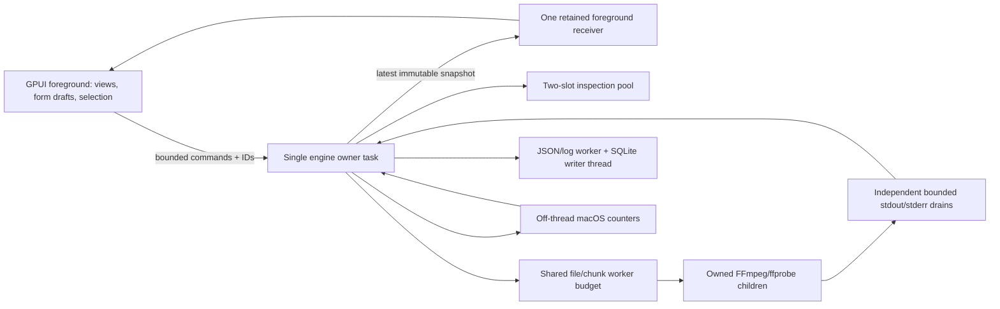
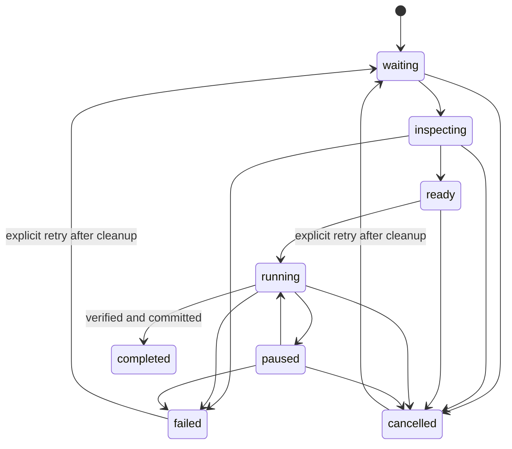

# Rust + GPUI Kit implementation handoff

**Status:** implementation instructions for a separate chat. This document does not mean a Rust application has been built or tested.

**Reference application:** the SwiftUI VideoConverter in this repository, baseline commit `c1818b25d70c8162eb0465d2b99274d7dd3a2590`. Read any subsequent changes before implementing. **Framework research:** November 5, 2026. **Target:** a native Rust macOS application using [Longbridge GPUI Kit](https://github.com/longbridge/gpui-kit), with the same layout, comparable appearance, and the complete feature set described below.

## 1. Start the implementation chat with this prompt

```text
Implement the Rust VideoConverter described in RUST_GPUI_IMPLEMENTATION.md.
Read that entire file, root AGENTS.md, README.md, the referenced Swift sources,
and the architecture/UI/chunk/telemetry documentation before changing code.

Create the Rust app under rust-gpui/ in this checkout. Preserve the Swift app,
its Xcode project, existing user data, and unrelated working-tree changes.
Use native Rust GPUI Kit controls, not a webview, Tauri, Electron, or Swift UI.
Match the existing four-screen layout, inspector, typography, colors, progress
indicators, keyboard interactions, and light/dark appearance.

Implement the real FFmpeg worker engine, bounded asynchronous command queue,
parallel files and optional parallel chunks, cancellation/pause, safe output
commit, queue recovery, local SQLite history, logs, and real macOS metrics.
Do not stop at a mock interface or a plan. Compile and launch the native app
early, then finish each implementation milestone with the required checks.
Use the same Rust core from the GUI and a headless stress runner. Port the
behavioral tests and generate synthetic fixtures; do not use personal media.

Revalidate the documented GPUI Kit release/toolchain before starting. Keep
Cargo.lock, document changes to this brief, and report actual checks, skips,
measured results, and remaining limitations honestly. Never claim Rust
performance from the existing Swift measurements.
```

This is a full implementation brief. Complete the required parity scope; use the optional backlog only after that scope works. Questions about routine crate/module choices should not interrupt progress. Seek clarification only for a material change to the requested framework, platform baseline, scope, or existing data.

## 2. Read first and use as the source of truth

| Reference | Use it for |
| --- | --- |
| [README](README.md), [agent instructions](AGENTS.md) | Current behavior, limitations, build commands, safety rules |
| [Architecture](Documentation/ARCHITECTURE.md), [diagrams](Documentation/DIAGRAMS.md) | Ownership, command flow, state machine, shutdown |
| [UI guide](Documentation/UI_GUIDE.md) | Screen map and workflows |
| [Queue screenshot](Documentation/Images/queue.png), [chunk screenshot](Documentation/Images/chunks.png), [metrics screenshot](Documentation/Images/metrics.png) | Actual appearance and interaction density |
| [Queue wireframe](Documentation/Images/queue-wireframe.svg), [observability wireframe](Documentation/Images/observability-wireframe.svg) | Editable layout maps; values and some styling are illustrative |
| [Chunk design](Documentation/CHUNKED_CONVERSION.md) | Eligibility, frame arithmetic, continuous audio, progress, tradeoffs |
| [Telemetry](Documentation/TELEMETRY.md) | SQL schema, timing units, buffering, retention, backup |
| [Stress results](Documentation/STRESS_RESULTS.md), [testing](Documentation/TESTING.md), [validation](Documentation/VALIDATION.md) | Existing evidence and regression scenarios |
| [Distribution](Documentation/DISTRIBUTION.md) | External tools, libraries, bundle resources, release limits |

Inspect these implementation files directly. The tables in this handoff summarize their behavior; they do not replace reading the command builder and tests:

| Swift reference | Rust responsibility |
| --- | --- |
| `Sources/ConverterCore/Models.swift` | Serializable models, settings, presets, snapshots, commands |
| `CommandBuilder.swift`, `ChunkPlanner.swift` | Validation, literal argument generation, safe frame/chunk plans |
| `ConversionEngine.swift` | Single owner of scheduler, jobs, reservations, attempts and lifecycle |
| `ProcessRunner.swift`, `MediaProbe.swift` | Tool discovery, signals, pipes, FFmpeg progress, ffprobe |
| `QueuePersistence.swift` | Recovery JSON and rotating logs |
| `Telemetry.swift`, `TelemetryDatabase.swift` | Real OS sampling and SQLite writer |
| `Sources/VideoConverter/VideoConverterApp.swift`, `AppStore.swift` | Native startup, menus, presentation bridge, file panels, quit |
| `ContentView.swift`, `QueueView.swift`, `InspectorView.swift` | Three-column conversion workspace and all settings |
| `LogsView.swift`, `MetricsView.swift`, `EngineView.swift` | The other three screens |
| `Tests/ConverterCoreTests/` | Executable behavioral contracts to port |
| `Sources/ConverterStress/main.swift`, `Scripts/*stress*.py`, `Scripts/analyze-telemetry.py` | Engine-driven benchmarks and analysis |

If a source behavior and this brief disagree, identify the difference, preserve safety, and document the resolution. Do not reproduce an observed bug merely to claim parity.

## 3. Scope and platform decisions

- Build a separate application named **VideoConverter Rust** initially; use the same visible workspace branding, with `macOS · Rust · FFmpeg` in the sidebar footer.
- Put a Cargo workspace in `rust-gpui/`. Keep the Swift app runnable and its existing tests untouched. Do not turn the root Swift package into a Cargo project or regenerate Xcode files for unrelated Rust changes.
- Use a distinct bundle ID, for example `com.giridharmb.VideoConverterRust`, and `~/Library/Application Support/VideoConverterRust/`. Verify the existing ID before finalizing. Never open the Swift app's live database for writing.
- macOS is the first supported platform. The Swift app supports macOS 14+; GPUI Kit's researched installation guide lists **macOS 15+**. Set the Rust baseline to macOS 15+ unless compatibility is established with real builds/runs. Do not advertise macOS 14 parity without evidence.
- GPUI Kit supporting Windows/Linux does not make this app cross-platform automatically. Keep process/metrics/native services behind small platform modules; mark other platforms unsupported until their behavior is implemented and tested.
- Keep FFmpeg libraries in isolated **ffmpeg/ffprobe child processes**. This matches the current application: it uses libavcodec/libavformat/etc. through executable frontends, not an in-process library binding. Do not add `ffmpeg-next` just to satisfy the word “libraries.”
- Support one local source and one managed final output per job. Multiple versions of a source are independent duplicated jobs. Arbitrary multi-input composition, capture, streaming servers, arbitrary multi-output graphs and mastering workflows are separate future features.
- The app must remain useful without installed FFmpeg: open normally, show the Engine unavailable state, allow configuration, and explain how to select tools. Never silently download or replace binaries.

## 4. Verified GPUI Kit baseline and bootstrap

### Release and dependency discipline

The official [getting-started](https://gpui-kit.com/docs/getting-started/) and [installation](https://gpui-kit.com/docs/installation/) pages consulted for this handoff show **0.9.0**. The inspected Git tag `v0.9.0` resolves to commit **`7591a35eced761e3613c01e71ff04c10129dae1a`**. Its `crates/kit/Cargo.toml` declares `gpui-kit` 0.9.0 and edition 2024; the workspace pins the upstream `gpui-pre-*` family to `=0.3.11`. A cached GitHub README returned an older 0.7 example. Use the selected release's source and matching docs, rather than mixing examples from different versions.

The registry endpoint could not be verified from this environment, so a successful crates.io resolution is **an implementation prerequisite, not a completed check**. Prefer the published release if available:

```toml
# rust-gpui/crates/app/Cargo.toml — relevant entries, not a complete manifest
[dependencies]
gpui-kit = "=0.9.0"

[dev-dependencies]
gpui-kit = { version = "=0.9.0", features = ["test-support"] }
```

If that exact release is unpublished or cannot resolve, inspect the cause. A documented reproducible fallback is the inspected source revision:

```toml
gpui-kit = { git = "https://github.com/longbridge/gpui-kit", rev = "7591a35eced761e3613c01e71ff04c10129dae1a" }
```

Use the same source/revision in normal and dev dependencies. Do not silently switch to moving `main`, downgrade, disable TLS checks, or override individual GPUI crates to make the build resolve. If a newer stable release is chosen, record its version/revision and verify the APIs again. Commit the resulting application `Cargo.lock`.

The Kit facade supplies `gpui_kit::*`, `gpui_kit::component`, `gpui_kit::base`, `gpui_kit::assets` and platform APIs. Default features include styled components and icons. Keep those defaults. Do not add a separately versioned `gpui`/`gpui-component` dependency or Cargo patches unless a specific verified need requires them. The optional `gpui-fast` backend is a later measured experiment; first establish parity using the default backend. JavaScript `gpui-shell` and webview features are unnecessary.

### Toolchain and startup gate

1. Check the selected macOS/Xcode SDK, Command Line Tools, `rustc`, and Cargo. The researched guide recommends Rust **1.92+** for its current full locked dependency graph; the actual resolved release may need newer. Pin the working stable toolchain in `rust-toolchain.toml`, including rustfmt/clippy. Do not assume this number is an immutable MSRV.
2. Resolve dependencies and compile a minimal native window before implementing the engine. Confirm visible text, icons, input and resize behavior. On this release Kit enables the macOS platform's `font-kit` support; do not add a nonexistent `gpui-kit/font-kit` feature.
3. Start through `gpui_kit::application()`, register `gpui_kit::assets::Assets`, call `gpui_kit::init(cx)` before components, then open the content Entity with `gpui_kit::open_window(...)`.
4. The Kit window helper installs its Root/overlay host. Return the application view from its closure, not another manually nested Root. Tests mounting views directly may need Root as shown in upstream test recipes; distinguish those cases.
5. Keep persistent control state, task handles and subscriptions on owning Entities. Do not rebuild `InputState`, selection state or subscriptions in `render`.

A startup outline, adapted to this application's names from the upstream Apache-2.0 consumer recipe; the implementing agent must compile it against the selected release:

```rust
use gpui_kit::{AppContext as _, WindowOptions};

fn main() {
    gpui_kit::application()
        .with_assets(gpui_kit::assets::Assets)
        .run(|cx| {
            gpui_kit::init(cx);
            // AppRoot::new and the runtime bridge are application code to implement.
            gpui_kit::open_window(WindowOptions::default(), cx, |window, cx| {
                cx.new(|cx| AppRoot::new(window, cx))
            })
            .expect("Unable to open VideoConverter Rust");
        });
}
```

Production startup must report an opening failure to stderr/local diagnostics and avoid leaving a windowless process. Set window bounds/minimum size, app identity, menus, reopen behavior and quit handling explicitly. `cargo build` alone is not proof the application opens. See [upstream bootstrap](https://github.com/longbridge/gpui-kit/blob/v0.9.0/examples/ai_recipes/src/bootstrap.rs) and [consumer tests](https://github.com/longbridge/gpui-kit/tree/v0.9.0/examples/ai_recipes).

### Component mapping

These paths/names were inspected in the selected release; verify signatures in source before use. Some upstream documentation fragments disagree with each other, especially retained resizable state; source and compiled recipes win.

| UI need | Kit approach |
| --- | --- |
| Actions, focus, key bindings, views | `gpui_kit` facade: `Entity`, `WeakEntity`, `Render`, `Context`, actions/focus APIs |
| Buttons and menus | `component::button::Button`; component menu/popover facilities |
| Text/numeric/expert fields | `component::input::{Input, InputState, InputEvent}`; retained text state, validated typed draft |
| Toggles and checkboxes | `component::switch::Switch`, `component::checkbox::Checkbox`; owner-controlled values and callbacks |
| Selects and preset picker | `component::select` state/delegate; retained selection; searchable custom codec text |
| Split panes | `component::resizable::{h_resizable, resizable_panel}` with size ranges; inspected styled `h_resizable` takes an ID |
| File/chunk progress | `component::progress::Progress`; this release's value is **0–100**, while domain fractions are **0–1** |
| Queue and logs | Virtual list facilities, stable row IDs and variable row heights for expanded chunks; inspect list delegate APIs |
| Metrics | `component::chart::{LineChart, AreaChart}` and plot primitives; preserve legends, units and dual-series CPU/I/O |
| Theme/icons | `component::{ActiveTheme, Theme, ThemeMode, IconName}` plus Kit assets; theme tokens, not hardcoded light-only text |
| Dialogs/notifications | Kit Root's overlay facilities; native path/save prompts through GPUI platform APIs |

Use application-specific cards/rows composed from Kit primitives. Do not replace the existing visual layout with a generic dockable IDE just because Kit offers Dock. Prefer the framework's native file prompts (`prompt_for_paths`, `prompt_for_new_path` in inspected examples); bridge platform services only when necessary. Compile the smallest real use of a component before spreading an assumed API across screens.

## 5. Workspace, dependencies and ownership

Suggested minimal layout; adjust filenames when implementation warrants it, not ownership boundaries:

```text
rust-gpui/
  Cargo.toml, Cargo.lock, rust-toolchain.toml, README.md, AGENTS.md
  crates/
    core/                         # no GPUI dependency
      src/{lib,models,commands,engine,process,probe,chunk,storage,telemetry}.rs
      src/platform/{mod,macos}.rs
      src/storage/{queue,database}.rs
      tests/                      # deterministic contracts + real FFmpeg tests
    app/
      src/{main,app,bridge,theme,actions,native}.rs
      src/views/{convert,job_row,inspector,logs,metrics,engine}.rs
      tests/                      # GPUI interaction tests
      resources/                  # tracked source icons; no bundled binaries
    stress/
      src/main.rs                 # CLI using exactly the production core
  scripts/                        # launch, local bundle, fixture/matrix adapters
  docs/{ARCHITECTURE,TESTING,TELEMETRY,PERFORMANCE,PACKAGING}.md
```

Use edition 2024, typed errors and ordinary modules. Avoid a plugin system, service locator, network daemon, generic workflow framework, dependency injection framework, or one crate per screen. Introduce a narrow process/clock/filesystem seam where tests need failure injection, not an abstraction for every struct.

| Dependency candidate | Purpose / constraint |
| --- | --- |
| `gpui-kit` | App only; selected verified release and matching dev test support |
| `tokio` | One runtime for core scheduling, process I/O, timers and channels; enable only needed process/io/sync/time/runtime features |
| `serde`, `serde_json` | Explicitly versioned JSON, FFprobe parsing, defaults and recovery |
| `uuid` | Stable job/session/log IDs; enable generation/serde as needed |
| `rusqlite` | One confined synchronous SQLite writer; default to macOS system SQLite for parity, document native linking; backup support if used |
| `thiserror` or a small error enum | Core typed failures; avoid string-only lifecycle state |
| `tracing`/subscriber, if needed | Local diagnostics bridged to bounded storage; do not install an unbounded asynchronous subscriber |
| Platform FFI crates or `libc` | Small audited macOS signal, process-counter, no-replace rename and power APIs |
| `tempfile` | Isolated integration tests, not a substitute for destination-volume output staging |

Versions beyond GPUI Kit are intentionally not guessed here. Resolve mutually compatible stable releases, record choices, inspect their primary API documentation, and pin the resolved graph. Use `std::path::PathBuf`/`OsString` for actual filesystem paths and process arguments. Do not round-trip a non-UTF-8 path through a lossy UI string. Define a reversible storage policy or return a clear unsupported-path error before adding a job.

## 6. Nonblocking architecture



### Presentation and runtime bridge

- GPUI owns the main/UI thread. Keep its Entity/Window/Context mutations there. The core cannot import GPUI types.
- Own one Tokio multithread runtime for the application's lifetime outside view rendering. Spawn the engine on that runtime through its Handle. Never call `Runtime::block_on`, block on a join, sleep, take a contended mutex, probe media, scan folders, serialize a large queue, run SQL or perform blocking filesystem work in a GPUI callback/render.
- **`cx.spawn` is foreground work**, not a background thread. It may await a channel/worker result, then perform a short Entity update and `cx.notify()`. Put synchronous work on a bounded blocking worker or GPUI background executor. Tokio I/O futures need the Tokio runtime; do not poll reactor-dependent work on a GPUI executor without a deliberate bridge.
- Store the foreground snapshot receiver Task and subscriptions on AppRoot/bridge. Use weak Entity updates and handle view disappearance. Dropping a GPUI Task cancels future polling; it does **not** kill FFmpeg. Dropping a Tokio JoinHandle ordinarily detaches the task; it is also **not** process cleanup. Core child ownership and shutdown are explicit.
- Keep one snapshot subscription alive across tab switches. Charts receive a sample revision/retained history only when metrics change. Do not spawn a new stream per render or hold a strong Entity cycle through its own task.
- Tab changes, row selection, form drafts, disclosure toggles and scrolling are immediate presentation actions. Queue mutations go through the engine; there is no reason to delay every harmless visual click through the conversion scheduler.

### Commands, acknowledgements and backpressure

Define a bounded FIFO `EngineCommand` channel, initially capacity 256, and attach a command ID plus reply/acknowledgement. Commands carry captured settings and stable IDs, not borrowed form state:

```text
Initialize; Add(paths, settings); Start; StopScheduling;
Pause(ids); Resume(ids); Cancel(ids); Retry(ids); Remove(ids);
Apply(ids, settings); Duplicate(ids, settings); MoveFirst(ids);
ClearFinished; ClearLiveLogs; SetConcurrency(1..8);
SetPreventSleep(bool); SetTools(directory); Shutdown.
```

`try_send` in a UI handler must return immediately. On a full queue, visibly reject that action with “Queue is busy; try again,” retain the current selection/draft, and record the rejection; never silently drop a click or spawn unlimited pending senders. An accepted command stays FIFO until acknowledged. Show pending/busy state for operations that need it. Use a bounded, separately owned shutdown request/latch so app quit cannot be stranded behind log traffic or an import flood. Once shutdown begins, reject new actions explicitly.

Control/lifecycle events must not share a lossy diagnostic channel. Progress may be latest-value coalesced and logs may be dropped with counters; child exit, cancellation, reservation release and final completion must reach the owner reliably. Child tasks return a result through retained task handles even if their progress channel overflows.

### Engine owner and job scheduling

- A single core task owns all jobs, ordering, attempts, output names, slot reservations, desired pause/cancel state and controller membership. Use immutable `Arc<EngineSnapshot>` values for readers, delivered by a latest-value/watch mechanism.
- The event loop must continue handling commands while probes, workers and storage are pending. Do not await a complete conversion or a busy SQL transaction inside a command handler. Spawn bounded owned work, collect completion events, and keep each operation's generation/attempt ID to reject stale results.
- Standard conversions reserve one worker slot. Chunk jobs reserve `min(requested_workers, available_slots, segment_count)` at launch, which can be one. Sum reservations across parent jobs; **never multiply queue slots by a full pool per file**.
- Global worker budget is 1–8, default 2. Inspection has a separate two-slot budget. Conversion reservations remain held through pause, chunk join, output verification, cleanup/reap and commit.
- Start enables launching eligible ready files. Stop queue prevents new parent files starting; already active chunk workflows may launch their remaining pieces/join. Lowering the budget limits future starts; do not kill existing work to meet it.
- Pause retains reservations. Retry, remove and settings mutation cannot race an outstanding worker; wait for all old children/tasks to be reaped before making the job eligible again. A terminal-looking cancellation label is not evidence cleanup has finished.
- Publish meaningful state/command changes promptly. Coalesce progress around 300 ms and metrics around 900 ms. Do not publish identical idle snapshots; do not clone all historical log strings on every frame.
- Recursive imports run off the UI thread with incremental bounded batches, cancellation and deterministic deduplication. Match current hidden/package/nonmedia handling after reading the engine. Guard directory cycles and report individual permission/probe errors. Explicit duplication still works when import deduplication would suppress the same source.

### State contract

Persist the public states `waiting`, `inspecting`, `ready`, `running`, `paused`, `completed`, `failed`, `cancelled`. Model preparing/joining/verifying/committing/reaping as typed internal stages with user-facing messages. A job reaches `completed` only after verification and successful final commit. Unknown duration gives an indeterminate bar, not fabricated ETA. FFmpeg `progress=end` alone does not mean success.



The diagram is an overview; enforce allowed actions in the engine and tests, including cancelling queued work, probe cancellation and restore-to-failed behavior.

## 7. UI specification: preserve layout and feel

### Visual authority and dimensions

Match the **running screenshots and Swift source** first. SVGs are annotated mockups, not pixel specifications; their dark navigation illustration must not force a dark sidebar in the light native app. GPUI controls can render differently from AppKit, but information hierarchy, screen positions, density, colors, interaction semantics and spacing must stay recognizable.

| Token / geometry | Required target |
| --- | --- |
| Initial window | 1440 × 920 logical points; native resizable titled window with traffic lights |
| Minimum window | 1150 × 740; scrolling/wrapping instead of clipped controls |
| Sidebar | min 220, ideal 235, max 270 points; horizontal inset 16, navigation gap 6 |
| Queue center | flexible, min 540; padding 24; major vertical gaps 18 |
| Inspector | min 340, ideal 380, max 440; user-resizable split; clamp at small widths |
| Other screens | padding 28; sidebar stays; inspector hidden |
| Inspector padding | header/content 20, segmented tabs 14, sticky footer 16 |
| Typography | system UI family; title 29 bold rounded approximation, eyebrow 10 semibold/tracking 2; rows 13 semibold; captions 10–12; diagnostics 11 monospace |
| Cards/controls | cards radius 12–14, drop target 16, buttons/nav radius 9–10, 1-point subtle borders |
| Accent/status | cyan/teal accent; green complete, red failed, orange pause/warning; purple memory/worker series |
| Surfaces | system-like window background, raised white/light cards, subtle separators; semantic dark equivalents |
| Numeric text | tabular/monospaced digits for changing counters, progress, speed and ETA |

Use central theme tokens and the Kit theme system. Starting custom colors may use teal `#0E9CAD`, secondary text `#63758A`, border `#DCE6EE`, with actual screenshot/system-color comparison guiding adjustment. These are application design starting points, not claimed exact Swift dynamic color values. Selected sidebar tint is roughly accent at 17%; icon tiles about 10–12%. Preserve readable selected-row text in both appearances. Avoid heavy shadows, decorative gradients everywhere, custom title-bar chrome or a dashboard redesign.

At minimum width, reconcile all three pane minima with dividers/title-bar insets, allow sidebar collapse as native navigation does, and keep Apply/Start reachable. Test actual content bounds rather than assuming the nominal dimensions sum exactly. Save sensible pane widths and restore with screen-bound clamping.

```text
┌──────────────────┬───────────────────────────────────┬──────────────────────┐
│ VideoConverter   │ CONVERSION STUDIO       Add media │ Conversion settings  │
│ YOUR MEDIA, ...  │ Make every format fit.            │ Selected / editable  │
│                  │ Subtitle                          │ Quick preset         │
│ Convert   count  │ [In queue] [Converting] [Completed]│ Detected media ▸     │
│ Logs             │ [Find media…]       [All statuses]│ Output Video Audio   │
│ Metrics          │                                   │ Expert               │
│ Engine           │ Selectable, scrollable job rows   │                      │
│                  │   filename                 state  │ Scrollable settings  │
│                  │   format → format, duration, size │ and contextual help  │
│                  │   ━━━━━━━━━━━━━━━━━━ progress     │                      │
│                  │   message / speed / FPS / ETA     │                      │
│                  │   ▸ Chunks / individual bars      │                      │
│                  │                                   │                      │
│ Engine status    │ Bulk actions       selected count │ Apply selected       │
│ Local privacy    │ status   Worker slots   Start/Stop│ Save import defaults │
└──────────────────┴───────────────────────────────────┴──────────────────────┘
```

### Sidebar and application interactions

Use the existing icon/branding hierarchy, four navigation entries **Convert, Logs, Metrics, Engine**, job count badge on Convert, engine connection indicator, privacy card and platform footer. Switching tabs must never restart subscriptions or conversions. Show persistence/telemetry errors in a nonmodal warning strip above content and preserve useful work.

Provide app menus and native keyboard behavior: Add Media `Cmd+O`, Add Folder `Cmd+Shift+O`, Start Queue `Cmd+R`, Stop scheduling `Cmd+.`, standard copy/paste/select-all in inputs, list selection and accessible context actions. Apply selection shortcuts only in the correct focus context. Focus should survive snapshots. Expose status names and progress values to accessibility; status is never color alone. Support VoiceOver, tooltips, reduced motion, system appearance, HiDPI and keyboard access to chunk disclosure. Lucide equivalents may replace SF Symbols while keeping similar size and intent.

### Convert screen

- Preserve heading “CONVERSION STUDIO / Make every format fit.” and subtitle “Drop your media. Choose a destination. Keep creating.” Add media menu contains file and folder actions.
- Three summary cards: **In queue** = nonterminal jobs, **Converting** = running parent files, **Completed** = completed jobs. These are not worker-process counts.
- Search filenames with a clear empty result state; status selector includes every public job state. Keep selection by UUID across filtering/snapshots and define Select all as the currently visible rows.
- Empty queue: dashed cyan drop region, import icon, “Your next conversion starts here,” detection explanation, Choose media button. Accept file/folder drops over the workspace and show an unobtrusive hover outline.
- Each row has media icon tile, elided filename/full-path tooltip, state icon/text, input→output format, detected duration/size, warning count, progress for running/paused/completed, stage/error message and active speed/FPS/output bytes/percentage/ETA. Failed messages allow at least two lines and full selectable diagnostics elsewhere.
- Use a virtualized list with stable IDs and genuine multi-selection (`Cmd`/`Shift`, keyboard). Expanded chunks require variable-height support or a deliberate bounded child panel; do not break selection or rebuild all rows on each progress report.
- Explicit Show/Hide chunk progress button: verified/total count, actual reserved workers, one named progress bar and status per segment; max 160-point scroll viewport. Completed segment bars persist. Paused parent makes active segment labels say Paused. Display Joining audio/video and Verifying separately.
- Context actions: Open media, Reveal in Finder, Pause, Resume, Retry, Cancel, Move to front, Duplicate job with its captured settings, Copy command (first chunk command for chunk mode), Remove. Enable only valid actions. Open/reveal prefers final output after completion, otherwise source as the reference does.
- Bulk menu: Select all visible, pause/resume/cancel/retry selected, move selected to front, duplicate with current inspector settings, remove selected, clear finished, export queue CSV report. Clearing/removing history never deletes media.
- Bottom status dot/text, **Worker slots 1–8**, and Start queue/Stop queue. Help explains shared file/chunk budget, paused reservations and per-process multithreading. Disable Start if tools are unavailable; Stop means stop scheduling, not cancel active work.

### Inspector semantics and every setting

Keep header, selection/editable count, Quick preset, single-selection Detected media disclosure, Output/Video/Audio/Expert segmented control, independently scrollable content and sticky Apply/Save footer. Detected media shows filename, format/duration/size/bitrate and every stream's index/type/codec/resolution/sample rate/channels/language, with Open/Finder actions.

The form is a **draft**. Selecting one job loads a copy. Apply changes only inactive eligible selected jobs; running, paused, inspecting and completed jobs retain settings, and reaping jobs must also be protected. Save defaults affects new imports, survives relaunch and does not apply retrospectively. Duplicate with current settings creates new IDs. Choosing a preset preserves output directory/suffix, resetting the other options including chunk mode as the reference does. Changing container updates the default audio codec, sets VP9 for WebM, and returns a previous VP9 selection to x264 when leaving WebM; do not change already captured jobs implicitly.

Keep contextual help next to complex settings. Retain text input buffers for incomplete numeric values (`-`, empty, fractional input); validate on appropriate events without resetting the cursor or panicking. Display unsupported combinations before launch; always repeat validation in the core.

| Pane | Control | Default / options / behavior |
| --- | --- | --- |
| Output | Container | MP4 default; video MP4/MKV/MOV/WebM/AVI; audio M4A/MP3/WAV/FLAC/Ogg/Opus/AAC |
| Output | Output directory | Empty = alongside each source; asynchronous Choose folder and Reset; selectable path |
| Output | Filename suffix | `_converted`; safe collision numbering; reject slash/NUL |
| Output | Trim start | 0 seconds; finite nonnegative; before known source end |
| Output | Duration | 0 = remainder; finite nonnegative |
| Output | Recover damaged packets | On; best-effort discardcorrupt/genpts/ignore_err, visible warnings and failures |
| Output | Preserve metadata & chapters | On; mapping controlled for standard and join inputs |
| Output | Optimize streaming | On; faststart for compatible MP4/MOV/M4A outputs |
| Output | Include subtitles | Off; optional subtitle mapping; mov_text for MP4/MOV, otherwise copy; explain bitmap/container limits |
| Video | Parallel chunks | Off; toggle plus worker/length controls and eligibility explanation |
| Video | Requested chunk workers | 4 default; up to 2–8, limited by shared queue slots |
| Video | Chunk seconds | 120 default; 1–3600, frame-aligned; extra temporary storage help |
| Video | Encoder picker + custom name | `libx264`; libx265, h264_videotoolbox, hevc_videotoolbox, libvpx-vp9, libaom-av1, mpeg4, prores_ks, copy; custom names accepted |
| Video | CRF slider/value | 23; integer 0–51; lower = larger/higher quality; not a promised size ratio |
| Video | Bitrate | Empty = encoder-dependent auto; e.g. 6000k; overrides generated CRF; VideoToolbox fallback 6000k |
| Video | Encoding speed | medium; ultrafast, superfast, veryfast, faster, fast, medium, slow, slower, veryslow; x264/x265 mapping |
| Video | Video stream | First by default; explicit ffprobe stream index for single selection |
| Video | Width / height | 0/0 preserves source; one zero preserves aspect using even auto dimension |
| Video | Frame rate | Empty = source; numeric or rational text such as 30000/1001 |
| Video | Deinterlace | Off; yadif; incompatible with video copy and initial chunk mode |
| Video | Filter chain | Empty; arbitrary FFmpeg video filter syntax after generated deinterlace/scaling |
| Audio | Exclude audio / mute | Off; audio-only output with mute is invalid |
| Audio | Encoder picker + custom name | aac; libmp3lame, libopus, libvorbis, flac, pcm_s16le, alac, copy; custom allowed |
| Audio | Bitrate | 192k; ignore for copy/lossless where builder does; do not add inappropriate flags |
| Audio | Sample rate | Source(0), 22050, 44100, 48000, 96000 Hz |
| Audio | Channels | Source(0), mono(1), stereo(2), 5.1(6), 7.1(8) |
| Audio | Audio stream | First by default; explicit ffprobe index |
| Audio | Include all audio tracks | Off; video containers only; audio-only output uses selected/first track |
| Audio | Normalize EBU R128 | Off; single-pass loudnorm, not two-pass measured mastering |
| Audio | Filter chain | Empty; arbitrary audio filter chain composed with normalization |
| Expert | Threads | 0 automatic; nonnegative per-worker hint, not an OS-wide thread cap |
| Expert | Before-input JSON argv | `[]`; multiline monospace editor, ~85 points high |
| Expert | Before-output JSON argv | `[]`; same; individual literal tokens, no shell |
| Expert | Build/copy preview | Requires one inspected source; build asynchronously from draft; chunk summary + first segment + join commands |
| Expert | Option reference | Link to official FFmpeg option docs; explain trusted options can write side files/access protocols |

Audio defaults by container: WebM/Opus→libopus; MP3→libmp3lame; WAV→pcm_s16le; FLAC→flac; Ogg→libvorbis; others→aac. A video container may hold audio-only input; do not invent video when the source has none. Video-only input can convert to video, while audio-only output requires enabled source audio.

| Quick preset | Overrides from normal defaults |
| --- | --- |
| MP4 · Balanced | MP4, libx264, aac, CRF 23, medium |
| MP4 · Smaller file (HEVC) | libx265, CRF 26 |
| MP4 · Apple hardware | h264_videotoolbox, video bitrate 6000k |
| WebM · VP9 | WebM, libvpx-vp9, libopus, CRF 32 |
| MKV · Preserve streams | MKV, video/audio copy, all audio, subtitles |
| MP3 · Extract audio | MP3, libmp3lame |
| FLAC · Lossless audio | FLAC, flac |

### Logs screen

Heading “EVERYTHING, EXPLAINED / Application logs,” description of commands/decoder diagnostics/job events. Toolbar: search, All levels/info/warning/error/debug, Selected jobs, Follow, Export, Clear view. Show timestamp, level, short job ID or APP, selectable monospace message and subtle error-row tint. Use a bounded virtual list; follow only when enabled and new rows arrive. Preserve selection/filter across navigation. Footer shows displayed count/2,000 live limit, Open log folder and rotation/SQLite/privacy explanation. Export filtered visible diagnostics to text without blocking rendering. Clearing view does not erase historical SQL/text logs.

### Metrics screen

Heading “LIVE OBSERVABILITY / See the whole workload.” Reveal database and Export CSV actions. First row: total CPU (100%=one core), app+worker physical footprint, disk write/sec. CPU and memory charts side by side; disk I/O full width below. Match ~155-point plot height, 18-point card padding, 16-point chart gaps; charts have axes, time units, legends and readable empty/baseline states. CPU: App cyan, Workers purple. Memory: purple area/line combined footprint in MiB. I/O: read cyan, write orange, MiB/s.

Second card row: workers, threads, thermal state, destination disk free. Show completed/failed/diagnostic totals, unavailable process count, rolling 300-sample history, sampling limitations, local retention and loss counters. Do not redraw charts for unrelated logs/progress. Use true multi-series plots or a shared plot primitive with identical axes; two independently scaled overlaid charts are misleading. SQL history can outlive the live chart, but the screen must not imply an unimplemented SQL history browser. Export the live samples with the same semantic CSV columns as `MetricsView.swift`.

### Engine screen

Heading “BUILT ON FFMPEG / Your engine. Your options.” Tool version/status card, selectable absolute ffmpeg/ffprobe paths, Choose FFmpeg folder, Auto-detect again, official documentation link, keep-awake toggle. Below: search all detected encoders/decoders/formats/filters/hardware backends and a scrollable selectable monospace capability report. Explain missing tools and configuration; capability availability does not guarantee every codec/profile/device combination succeeds. Keep paths/runtime diagnostics out of decorative conversion controls.

## 8. Domain data and compatibility

Translate model semantics, not Swift actor syntax. Use owned cloneable `Send` values, explicit integer widths, finite numeric validation and rational frame types. Required records:

- `ConversionSettings`: every field/default in the settings table, `Option<ChunkSettings>` off by default, optional explicit audio/video stream indices, literal expert arrays and stable serialized field names.
- `ConversionJob`: UUID, source path, optional reserved/final output, state/stage, captured settings, optional media, progress, message, warning count, created/started/finished times, argv vector, current owned PIDs for live display, optional chunk progress, phase timings and attempt number. Restored PIDs are informational garbage to clear, never process authority.
- `MediaInfo`: duration seconds, byte size, format name, bitrate, optional container start; streams with index, codec, type, width/height, sample rate, channels, average/nominal rational rate, language, optional duration/frame count/start time. Accept ffprobe's missing/string/`N/A` fields without panics.
- `JobProgress`: fraction, encoded seconds, speed multiplier, FPS, output bytes, frame count, optional ETA. Parse `out_time_us` correctly; FFmpeg's historical `out_time_ms` label may also contain microseconds. Follow the existing parser/tests, handle chunked reads and cap invalid/nonfinite values.
- `ChunkProgress`: actual workers, ordered segment IDs/durations/states/progress. User labels are one-based; plan/event indices are zero-based.
- `JobTimings`: inspection, planning, preparation, encoding, verification, commit milliseconds and output bytes. Keep reached-phase durations on failure/cancel.
- `LogEntry`: UUID/time/level/optional job/message; `MetricSample`: exact fields from section 12.
- `EngineSnapshot`: sequence, publish time, jobs/logs/metrics revisions, tool info/capabilities, scheduling flag, budget, keep-awake, persistence/telemetry errors, database/session info and all loss counters.

Rust recovery uses its own documented versioned JSON envelope. Add fields with intentional `serde(default)`/optional migrations, not blanket silent recovery from malformed input. Preserve and disable overwriting on unreadable/newer schema files. Persist application defaults separately from captured job settings.

**Do not assume Swift JSON is Rust JSON.** Existing Swift dates use Foundation's default seconds-since-2001 encoding; SQL timestamps use Unix seconds. URL representation, optional fields, enum spelling and camelCase also need explicit mapping. Automatic live migration is not initial parity scope. If importing Swift queue history is added, use an explicit read-only copy/import command, preserve backups, validate versions and normalize interrupted jobs. Never share a live `queue.json`, use stored PIDs or overwrite the original source store. SQL compatibility likewise requires tests, not matching filenames.

## 9. FFmpeg execution and output integrity

### Discovery, argv and probing

- Resolve an explicit configured directory first when set; otherwise bundle `Contents/Resources/Tools`, `/opt/homebrew/bin`, `/usr/local/bin`, `/usr/bin`, then inherited PATH. Require both tools executable and validate by launching them off-thread. Finder launches can have a restricted PATH.
- Inspect the exact FFmpeg version/build and query capabilities using the reference's commands. Do not infer encoders from hardcoded picker choices. Capture tool-change generation so stale results cannot replace a newly selected build.
- Execute with `tokio::process::Command`/literal args, no shell. Human command quoting is display/copy only. Keep executable, inputs and final managed staging path under application control.
- Preserve generated `-hide_banner -nostdin -n -loglevel warning -nostats -stats_period 0.3 -progress pipe:1`. Recovery adds `-fflags +discardcorrupt+genpts -err_detect ignore_err`. Preserve trim, maps, copy restrictions, codec-specific quality/preset/pixel-format mapping, filter order, subtitle mapping, metadata/chapters, faststart and thread placement from the Swift builders.
- Expert JSON must be an array of strings; reject NUL and reserved flags `-y`, `-n`, `-i`, `-progress`, `-stats_period`, `-stdin`, `-nostdin`, `-stats`, `-nostats`, including `flag=value` spelling. Do not parse shell strings. Explain these are trusted FFmpeg options, not a sandbox against protocol or side-file access.
- Validate negative/nonfinite numbers, invalid quality, trim outside source, nonexistent selected streams, no remaining A/V, filters/resampling with copy and unsupported chunk combinations before launching. Do not silently replace codecs or settings after failure.
- Inspect/verify with a 60-second active-time timeout excluding deliberate pauses. Decode JSON with size limits and explicit errors; unknown duration is allowed in standard mode where safe, but not chunk planning.

### Process lifecycle

Each live child has an owner controller with a generation, cancellation token, desired pause state, child handle and completion result. Register ownership before signalling; serialize launch/pause/cancel races. One controller can be reused sequentially by its pool lane only after the previous child is reaped. Do not identify ownership solely with an integer PID; guard against stale events, PID reuse and post-exit escalation.

Drain stdout and stderr concurrently, even during cancellation. Pause sends SIGSTOP, resume SIGCONT. Cancellation records intent before launch, resumes a stopped process, sends SIGTERM, then SIGKILL after two seconds if the same owned child remains alive. Await process exit and pipe drains before releasing reservations or accepting retry. `kill_on_drop` is only a last-resort guard, not the shutdown design. Any blocking reader/SQL owner must have a bounded shutdown path. Prevent cancelled verification from committing output.

A bad file, decoder crash, disk error or failed chunk fails its parent job; unrelated jobs proceed. Successful exit can still carry warnings. Keep bounded stderr tail for failed diagnostics. Count lost stream events separately from naturally removed live history.

### Destination transaction

1. Select a source-safe unique final filename with `_2`, `_3`, etc.; check current files and engine reservations, canonical parent/source identity and case-insensitive macOS volume behavior. Reject destination/source aliasing and malformed suffixes.
2. Reserve the name before dispatch. Create an owned hidden staging directory on the destination volume, for example `.videoconverter-rust-<UUID>/output.ext`. Validate ownership before cleanup; do not recursively remove a path supplied by a saved queue without confirming it belongs to that job. Use safe directory handling around symlinks.
3. Require at least 100 MiB available before encoding, explaining this is only a minimum check. ENOSPC still fails normally. Keep original and existing destination files intact.
4. Encode with `-n`. Require exit success, nonempty file and valid expected A/V structure from ffprobe. Chunk mode also checks frame/duration contracts. Verification is structural, not full decode/perceptual proof.
5. Recheck cancellation and atomically **commit without replacement** on the same filesystem. On macOS use an audited `renamex_np`/`renameatx_np` with `RENAME_EXCL` or a demonstrably equivalent primitive. Check the SDK's contract and filesystem support; fail safely if unavailable.
6. A new collision at commit fails safely; retry chooses a fresh name. Only a successful commit sets 100%/completed and removes successful staging. Retain failed/cancelled staging for diagnosis. Retry cleans only its own prior staging, restarting the entire file. Removing history never deletes staging, input or final media.

**Rust-specific trap:** [`std::fs::rename`](https://doc.rust-lang.org/std/fs/fn.rename.html) replaces an existing destination. `exists()` followed by `rename()` has a race and is not a no-overwrite transaction. Do not use either pattern for final media. Queue JSON replacement is a different operation and may intentionally replace its own previous state atomically. Document filesystem durability separately from atomic visibility; do not promise power-loss durability merely because rename is atomic.

## 10. Parallel chunks for one large source

Port `ChunkPlanner.swift` and `ChunkTests.swift` carefully. A 3 GB file does not imply a speedup: FFmpeg already parallelizes encoders. Keep standard mode the default and the user's manual choice visible.

### Eligibility and exact timeline

- Local seekable source with usable video timing; output MP4/MOV/MKV; encoder **libx264 or libx265** only. Refresh metadata on chunk apply/duplicate/retry, including old saved probes missing timing fields.
- Reject audio-only formats, video copy, hardware/VP9/AV1 encoders, subtitles, deinterlace, custom video filter chain, nonempty expert arrays and audio stream copy when audio is enabled. Allow scaling, quality/bitrate/preset, mute, selected/all audio and normal audio processing.
- Choose explicit output rate or detected average rate; support numeric/rational rates **1–240 fps**, including 30000/1001. Use checked rational/frame arithmetic, the reference's bounded rational conversion (fraction denominator up to 1,000,000), bounded numerator and overflow checks.
- Use source frame count/rate for duration when valid, then stream duration, then container duration. Round trim start forward to a frame, requested duration down to complete frames, chunk seconds down to whole frames. Total frame limit 1,000,000,000, at most 4,096 chunks. A short source can yield one chunk.
- Reject known stream/container start offset beyond one output frame and clearly inconsistent average/nominal rates (relative difference over 0.1%, as the reference). These checks are heuristics, not proof of constant frame rate. Warn/document standard mode for VFR, timestamp gaps, edit lists or unreliable damaged-media indexes. Do not promise arbitrary VFR frame identity.

### Bounded execution and join

1. Capture actual workers from remaining global slots at parent launch. Create exactly that many sequential pool lanes/controllers; no task/process per every segment at once. Hold the parent's reservation through the entire workflow.
2. Automatic encoder threads use available CPUs/actual workers, at least one, or the explicit per-worker hint. Preserve x265 bounded pool/frame-thread hints and closed GOP, plus reference decoder/filter thread hints. Native codecs can still create extra threads.
3. Produce video-only `video-00000.mp4` etc. with identical encoding parameters, common rational FPS/time base, closed GOP and `setpts=PTS-STARTPTS`. Accurate seek uses the reference's downward microsecond rounding with its one-microsecond allowance; each piece sets an explicit expected frame count. Do not replace this with imprecise `duration / workers` seeking.
4. Probe every piece and require its expected MP4 video frame count. Missing/failed/wrong-count segments fail the parent and cancel/reap siblings. Never concatenate a partial subset.
5. Write an ordered `ffconcat version 1.0` manifest with controlled ASCII **relative** filenames and exact frame-derived durations. Keep concat safe mode enabled; no user paths inserted into manifest syntax.
6. Final FFmpeg input 0 is concatenated verified video; copy its video. Input 1 is the original source for **one continuous audio encode** plus metadata/chapters, trimmed using the aligned timeline. Respect mute, selected/all tracks, audio filters, metadata and faststart. Never encode lossy audio independently in each segment.
7. Final duration uses planned frames/FPS. Require video and duration within `max(0.15 seconds, 2/FPS)`, exact final video frame count when exposed, nonempty file and normal safe commit. MKV may not expose a frame count; retain the duration/stream checks rather than inventing one.
8. Pause/resume/cancel affect all current and future children, including probes/join. Parent task ownership ends only after every child exits. Retry restarts all pieces; completed-piece resume is not implemented.

### Progress and honest tradeoffs

Parent fraction = 85% duration-weighted segment encoding/verification + 13% join/audio + 2% final verification/commit. Never reach 100% until committed. Each segment exposes its own fraction/state; do not report “verified” at encoder exit before its probe. Aggregate speed/FPS from currently encoding pieces; encoding ETA excludes final joining/verification and must say so. Do not add the same parent/child output bytes twice; label stage byte counts or show a clearly defined temporary-output total.

Chunks and final output temporarily coexist. Closed GOP and reset rate control can change size/quality at a given CRF. Document temporary-space needs, memory/thermal costs, seek overhead and lack of guaranteed acceleration. Include standard vs 2/4/8-worker comparisons, both auto threads and fixed threads, in the Rust benchmark results.

## 11. Recovery JSON, logs and local SQLite

### Storage policy

Use `~/Library/Application Support/VideoConverterRust/` for `queue.json`, defaults/config, `application.log`, `application.previous.log`, `telemetry.sqlite` and SQLite side files. Use appropriate private directory/file permissions (database owner-only). Tests and stress scenarios require separate temporary/configurable directories. A second app instance must reuse/activate the first or refuse a concurrent writer for the same store; implement/document the lock policy.

Persist queue changes atomically around once per second through an off-thread owner. Flush normal shutdown. Restore history and settings with scheduling **stopped**; interrupted active work becomes failed/manual-retry, without signalling stored PIDs. Preserve undecodable/newer files and disable writes until the user moves/repairs them. Do not reset to an empty queue. Save defaults independently; JSON is authoritative for queue recovery, SQLite is diagnostic history.

### Bounded buffers

Match the current bounds initially, then improve only with measured/documented reasoning:

| Buffer | Initial bound / policy |
| --- | --- |
| Captured stdout | 16 MiB; fail oversized required probe/capability results clearly rather than parsing truncated JSON |
| Stderr error tail | 64 KiB, retained independently of live event loss |
| Individual diagnostic line | 8,192 Unicode characters; bound decoder accumulation before newline as well |
| Per-controller process events | 256; stderr batches at most 16 lines |
| Live UI logs / metrics | 2,000 entries / 300 samples |
| Pending logs | 4,096; one burst flusher starts at 512 |
| Pending changed job-attempt records | 4,096, coalesce by key |
| Pending metrics / operations | 300 / 4,096 |
| Text log rotation | Approximately 5 MiB and one previous file |

Discard oldest excess **diagnostics** with visible total/process-stream/pending-buffer/database loss counters. A dropped stderr batch counts constituent lines; dropped progress counts an event. Normal live-ring trimming and retention pruning are not ingestion loss. Count limits alone are not byte quotas; test Unicode and long-line worst cases and add a byte cap if necessary. Ensure shutdown flushes pending persisted records, not just the smaller UI ring.

### SQLite writer and schema

Own one `rusqlite::Connection` on a dedicated writer thread. Use a bounded command/batch channel; never share a mutex-protected connection with render code. Use prepared bound statements in short transactions with rollback. Use WAL, `synchronous=NORMAL`, foreign keys, busy timeout **100 ms**, auto-checkpoint **1,000 pages**, versioned migrations and passive checkpoint after normal final flush. SQL failure must report lost diagnostics/error and leave conversions running. No retries that indefinitely stall scheduling or grow memory.

Start from the exact schema in `Sources/ConverterCore/TelemetryDatabase.swift`, including indexes and column names so existing analysis can be adapted with minimal changes. Copy its DDL into a checked-in Rust migration, test it and document any deliberate divergence. Its semantic inventory:

| Table | Columns to preserve |
| --- | --- |
| `sessions` | `id` PK, `label`, `started_at`, `finished_at`, `logical_cpus`, `physical_memory_bytes` |
| `jobs` | PK `(session_id,id,attempt)`; `input_path,input_format,input_bytes,input_duration,output_path,output_format,video_codec,audio_codec,quality,encoder_threads,state,message,warnings,created_at,started_at,finished_at,inspection_ms,planning_ms,preparation_ms,encoding_ms,verification_ms,commit_ms,output_bytes,settings_json` |
| `logs` | PK `(session_id,id)`; `at,level,job_id,message` |
| `metrics` | `session_id,at,app_cpu,worker_cpu,app_memory,worker_memory,read_bps,write_bps,threads,workers,thermal,disk_free,unavailable` |
| `operations` | `session_id,at,job_id,name,duration_ms,detail` |

All child tables reference sessions with cascade deletion. Schema `user_version=1` is the baseline, not permission to open/write the Swift DB. Reject unsupported future schema versions without dropping data. If extending fields, migrate transactionally and update the Rust version and analyzer. Never interpolate paths/logs into SQL. Handle invalid/nonfinite settings in a diagnostic-safe representation so serialization failure for one job cannot lose an unrelated batch.

Unix seconds for SQL timestamps; monotonic clocks for durations. Attempts are separate history rows even when job UUID repeats. Record phase timings on failure/cancel. For chunks, `encoding_ms` includes chunk encoding/probes/join; `verification_ms` is final verification. `started_at` marks allocation, so queue wait is not encoding time.

Keep operation names compatible: `command`, `engine_tick`, `database_flush`, `actor_ping`, `ui_snapshot_delivery`, `ui_heartbeat_lag`, `ui_tab`, `telemetry_health`, `scenario_config`, `batch_wall`, `chunk_plan`, `chunk_total`, `chunk_verify`, `chunk_join`. Include command ID/attempt/stage in detail as needed. A command's processing duration differs from enqueue-to-ack latency; measure both with distinct names if adding the latter. Do not interpret awaits inside engine_tick as continuous engine occupancy or actor_ping as GUI FPS.

On open and every 300 batches: prune sessions older than 30 days except the writer's current session; retain latest 100 finished sessions; retain at most 100,000 logs/metrics/operations each after pruning. Jobs follow session deletion. Preserve current long-running sessions. This is a row/history policy, not a strict disk quota; WAL/freed pages can remain. Document normal close/failure handling.

Reveal the database through Metrics. Provide a safe export/analysis workflow using SQLite backup API/CLI `.backup` or a cleanly closed writer; **never copy only the main file of a live WAL database**. No remote analytics, crash upload, cloud account or network telemetry is required. Paths/settings/metadata can be private: generated DBs, media, logs and raw exports remain ignored, with only reviewed path-free summaries committed.

## 12. Real metrics and responsiveness

macOS adapter responsibilities:

- Read app and every currently owned worker/probe PID through `proc_pid_rusage`/`proc_pidinfo` or an equivalent verified native API; identify process lifetime, clear baselines after exit, and handle missing permission/exited processes honestly.
- CPU = delta(user+system CPU time) / monotonic elapsed × 100. The reference rusage times require Mach timebase conversion; do not treat Apple Silicon ticks as nanoseconds. Calibrate against an independent process CPU measurement. 100% means one logical core; parallel totals may exceed 100%.
- Memory = **physical footprint** (`ri_phys_footprint`) for app and summed live children. Generic RSS from a convenience crate is not automatically equivalent. If substituting another metric, relabel it and document the difference rather than claiming identical numbers.
- I/O = nonnegative deltas of kernel-accounted physical read/write bytes per second, summed without underflow across live process lifetimes. Cache hits can read as zero. Do not substitute FFmpeg's encoded byte count for physical disk I/O.
- Threads = app plus live workers; worker count = available current child counters, with unavailable processes counted separately. A very short process may produce no CPU delta. Display this limitation, not a false zero-work inference.
- Thermal state = real native Nominal/Fair/Serious/Critical/Unknown; destination free space = first running output volume, otherwise home as the reference. If a query fails, show unavailable, not healthy/zero by default.
- Sample off-thread about every 900 ms, retain 300 samples. Baseline first samples appropriately. Use sample revision to avoid rebuilding charts on progress-only updates.
- Keep-awake uses a native idle-system-sleep assertion only while work runs; release on pause/idle/shutdown/error. Display sleep/manual sleep remain possible. Keep FFI and ownership cleanup small and auditable.

Required sample fields: timestamp, app/worker CPU %, app/worker memory bytes, read/write B/s, threads, active workers, thermal state, available disk bytes, unavailable processes. No fabricated GPU, power, network, system-wide I/O, quality or thermal throttling percentage. Those need new verified providers and clear semantics before becoming options.

Measure GPUI main-thread responsiveness: a ~100 ms heartbeat's additional wakeup delay, snapshot publish→apply delay, accepted command enqueue→ack, visible list scroll/focus behavior under load, and optional Kit profiler frame events. Keep an owned timer; avoid busy polling. Define performance targets before collecting results, for example p95 enqueue→ack under 100 ms and p95 additional UI heartbeat delay under 50 ms on the recorded test host. These are **goals to assess**, not current guarantees; initialization, file scans and actual conversion completion are separate. Investigate p99/max and cancellation latency even when averages look good. Record profiler overhead and compare Release builds.

## 13. Native lifecycle and packaging

- Provide a documented `cargo run ...` path and a local `.app` bundle script. Rust does not run through the existing Swift Xcode scheme. A Cargo executable is not an app bundle; package `Contents/MacOS`, `Contents/Resources`, Info.plist, icon, minimum OS, bundle ID and versions.
- Resolve resources relative to the installed bundle, not the current working directory. Launch from Finder with no terminal environment. Confirm menus, text/icons, window activation, reopening and quit.
- User closes/reopens the main window: define macOS behavior and avoid a hidden unmanageable queue. Keep one primary window; reopening focuses or recreates it. Closing a view must not accidentally drop the engine's runtime while workers survive.
- With active work, Quit offers **Keep converting** or **Stop and quit**. Stop-and-quit stops acceptance/scheduling, cancels probes/children, awaits reaping and retained engine tasks, releases power assertions, flushes queue/log/SQL, ends the session, then exits. Do not wait synchronously on the UI thread. Show a shutdown state if cleanup is taking time.
- External FFmpeg is supported first. Reuse/adapt the existing local bundle tool only deliberately: Rust bundle layout, architecture, Mach-O library closure and paths must be validated independently. Do not copy untracked local binaries into Git or silently fetch third-party packages.
- Keep source assets and notices tracked, generated tools/target/dist/runtime files ignored. A source-only clone must build without a missing resource directory and open to an actionable missing-engine state.
- Start with unsandboxed local development, matching the current process architecture. App Store sandbox/bookmarks/helpers, signed/notarized distribution, universal binaries and automatic updates are separate release work. Do not label a local ad hoc bundle production-ready. Audit dependency/FFmpeg licensing and native code signatures when preparing a distribution; preserve upstream notices.

## 14. Tests and acceptance gates

Use ordinary Rust tests for pure core logic, real FFmpeg integration tests for media/process behavior and GPUI Kit tests for UI ownership/interactions. Port the intent of existing tests; do not transliterate implementation-private assertions or count skipped tests as passes. Use disposable directories, isolated stores and shutdown in every engine test. Detect missing FFmpeg and report media-test skips explicitly; release acceptance requires actually running the media suite with supported tools.

### Core and process tests

- Every preset, container/audio default, stream mapping, bitrate/CRF rule, filter order, metadata/subtitle/faststart mapping, valid trim and copy restriction.
- Expert JSON parse/type/reserved flags/equals forms/NUL; filenames with spaces, quotes, Unicode and shell metacharacters remain literal. Display quoting is never execution input.
- Output/source identity, concurrent reservation collision, external collision introduced at commit, unsupported no-replace filesystem, failed directory/permission/ENOSPC, staged verification failure and cancellation before commit. Confirm existing-file bytes remain identical.
- FFprobe missing fields/`N/A`/malformed/oversized JSON; streaming progress split across reads, unknown duration, nonfinite fields, exit-after-progress-end failure.
- Thousands of interleaved stdout/stderr lines with bounded memory/tail, one extremely long no-newline line, UTF-8 boundary fragments, backpressure/loss counters and reliable child-exit result.
- Pause/cancel before/during launch, while paused, during probe/join/verification, SIGTERM escalation, repeated cancel and quit; no leaked children, stale signals or released-early slots. Probe timeout excludes pause.
- Global budget across mixed normal/chunk files, paused reservations, lower-limit future behavior, stop scheduling, FIFO/reorder, deduplication/explicit duplicates, invalid file isolation, cancelled job not retryable until reaped.
- Queue/default version upgrades, absent optional fields, unreadable/future JSON preservation, restored active→failed with no auto-start, store locking, atomic save failure, shutdown flush.
- SQL schema/foreign keys, bound malicious-looking log strings, duplicate IDs, separate retry attempts, batch rollback, future versions, retention beyond 30-day current session, lock contention, telemetry failure while conversion still succeeds, safe backup and nonfinite diagnostic representation.
- Real CPU calibration and footprint/I/O units, missing/dead process counters and process generation reuse; immutable latest-snapshot behavior under a slow subscriber.

### Chunk correctness tests

- Rational FPS, source duration priority, aligned nonzero trim, nondivisible final segment, short source, exact boundaries/limits/overflow, rejected settings/start offsets/rate mismatch.
- H.264 and HEVC to MP4/MOV/MKV, mute, selected/all audio, scaling, metadata/chapters and final verification. Confirm manifest order/safe names and frame durations.
- Lossless synthetic video: decoded frame hashes match the expected CFR frame sequence across every boundary and trimmed range. Do not compare lossy encoded bytes to claim frame identity.
- Continuous audio: compare decoded PCM to a single matching reference audio encode over the same timeline; inspect delay/padding and A/V duration. No per-segment lossy audio encodes.
- Failure of one segment cancels/reaps siblings, prevents join, leaves unrelated file conversions running and retains diagnostics; retry cleans only its own stage and restarts all pieces.
- Actual worker slots, progress weights/verified states, pause/resume future segments, cancellation during join, completed per-segment bars and final 100%-after-commit.

### GPUI interaction and visual checks

Enable Kit `test-support` in app dev-dependencies and use `#[gpui_kit::test]` with explicit imports. Its macro can shadow ordinary `#[test]` under glob imports; keep core tests ordinary Rust. Test actual mounted production views and action callbacks, not a duplicate test-only UI. Follow the [testing guide](https://gpui-kit.com/docs/test/) and release consumer recipes; test windows are not native packaging/accessibility evidence.

Required interactions: input text survives unrelated snapshots/redraws, settings Apply vs defaults semantics, multi-selection/context/bulk actions, tab continuity during conversion, focus/keyboard shortcuts, status search/filter, per-chunk disclosure/progress, Follow vs manual log scrolling, disabled actions, missing-engine startup, bounded command rejection feedback, persistence-error warning and asynchronous quit.

Launch the real Release application for screenshot comparison at 1440×920 and minimum size, light/dark, @1x/@2x where available. Inspect all four screens and inspector panes, empty queue, mixed states, active parallel conversions, expanded chunks, warning/error displays and long paths. Use synthetic media and review screenshots for private paths. Verify VoiceOver/keyboard/reduced motion natively. Do not call a mocked image a screenshot of the implementation.

### Working build commands

Define these package names when creating manifests so the commands remain usable:

```sh
cd rust-gpui
cargo fmt --all -- --check
cargo clippy --workspace --all-targets --locked -- -D warnings
cargo test --workspace --locked
cargo build --release --locked -p video-converter-app -p video-converter-stress
cargo run --locked -p video-converter-app
```

Core package: `video-converter-core`; app: `video-converter-app`; headless runner: `video-converter-stress`. Any native-rendering/platform test requiring a desktop session must be identified and run separately when needed. A test harness that passes without a real GPU/native window cannot establish Finder launch or UI pixel parity. Keep feature-enabled app tests and resource packaging in CI where the runner supports them.

## 15. Stress testing and bottleneck analysis

Implement the stress CLI against the **same Rust engine** and storage code, with configurable tools, isolated storage, label/tag, concurrency, threads, settings profiles, chunk configuration and deadlines. Reuse the existing Python fixture generator; adapt the matrix runner to select the Rust binary without changing what Swift comparisons mean. Do not accidentally benchmark the Swift runner and label it Rust.

Required workloads:

1. Synthetic MP4/MKV/MOV/WebM/AVI with audio, target **1,000,000 bytes ±5%**, using `Scripts/make-stress-fixtures.py`; retain source size/duration/rate/codec manifest. Compression output is not padded to force a ratio.
2. Video→video: H.264 CRFs 18/23/28, HEVC/VP9 profiles and compatible stream copy; audio extraction: MP3/AAC bitrates, FLAC/WAV. Track actual encoder availability and expected skips.
3. Parallel budgets 1/2/4/8, threads automatic/2, repeated at least three times with interleaved configurations and scenarios executed sequentially. Add invalid/truncated files to check failure isolation and recovery.
4. Log flood and long-line workload; slow snapshot subscriber; concurrent read-only SQL analysis/lock contention; repeated import/apply/pause/resume/cancel/retry; sustained bounded memory after completion.
5. Single-video standard vs 2/4/8 chunk workers, several chunk lengths, H.264/HEVC, fixed and automatic threads, validating every output. Begin with a short reproducible source; include an explicit longer synthetic **~3 GB** case only when disk/time permit and actually generated/measured. Never extrapolate a short run into a completed 3 GB stress test.
6. GUI open on Convert/Logs/Metrics during bounded parallel workloads, scrolling and editing drafts; UI heartbeat/snapshot/ack/frame observations separately from headless throughput. Add a longer soak for thermal/memory growth once short tests pass.

Record release revision, Rust/dependency/tool versions, FFmpeg build, host/OS/architecture/CPU/RAM, fixture bytes and exact media parameters, thread hints, slot/workers, repetitions, cache/thermal context, wall time, per-phase p50/p95/p99/max, jobs/sec, bytes ratios, peak sampled app/worker footprint/threads/I/O, unavailable counters, diagnostic losses, expected negative failures and unexpected valid-input failures. Fixture generation, compilation, doc rendering and other scenarios stay outside timed batches. Distinguish sampled peaks from true peaks, headless actor latency from frames, and encoding size from perceptual quality.

Analyze the resulting Rust SQLite store, rather than relying only on CLI output:

```sql
PRAGMA quick_check;
PRAGMA foreign_key_check;
SELECT s.label,j.state,count(*)
  FROM jobs j JOIN sessions s ON s.id=j.session_id
 GROUP BY s.label,j.state;
SELECT name,count(*),round(avg(duration_ms),3),round(max(duration_ms),3)
  FROM operations GROUP BY name;
SELECT output_format,video_codec,quality,encoder_threads,
       round(avg(encoding_ms),2),round(avg(verification_ms),2),
       round(avg(1.0*output_bytes/NULLIF(input_bytes,0)),3)
  FROM jobs WHERE state='completed'
 GROUP BY output_format,video_codec,quality,encoder_threads;
```

Adapt `Scripts/analyze-telemetry.py` with an explicit database option if necessary, preserving read-only behavior and existing Swift usage. Compute interpolated percentiles, session comparisons and expected-control separation. Investigate command/heartbeat spikes against database_flush, queue serialization, log volume, worker threads, thermal state and sample gaps. Check WAL growth, query plans/index usage and retained row counts before blaming SQLite. Optimize one supported bottleneck, rerun the comparable case and preserve output checks. Do not remove verification or measurements to improve numbers.

Existing **Swift**, not Rust, evidence: the 30-second 720p comparison in [chunk results](Documentation/CHUNKED_CONVERSION.md) found automatically threaded standard encoding faster than chunking; four workers helped only against a two-thread-constrained standard encoder and used more sampled memory. Earlier [stress results](Documentation/STRESS_RESULTS.md) include bounded telemetry improvements and remaining latency spikes. Treat those as hypotheses/reference workloads, not Rust speed guarantees. No genuine 3 GB Rust run has occurred as part of this handoff.

Commit only reviewed path-free summaries/manifests/charts and a clear report of what ran. Keep media/output/DB/WAL/SHM/raw logs under ignored build/target directories. Preserve local evidence until summarized; do not publish private machine paths or original media.

## 16. Implementation milestones and deliverables

Complete each stage with runnable code and evidence; do not spend the whole task producing placeholders for all screens.

| Stage | Required result / exit gate |
| --- | --- |
| 1 — Bootstrap | Locked dependencies, actual native window with text/icons, four navigation entries, theme, initial/minimum sizes, real startup/shutdown; launch observed |
| 2 — Core standard conversion | Typed settings/probes/argv, one real conversion with staged verified no-replace commit; meaningful safety/process tests |
| 3 — Queue and Convert UI | FIFO accepted commands, latest snapshots, parallel budget, row selection/imports/inspector/all normal options, pause/cancel/retry, bulk actions; native nonblocking check |
| 4 — Persistence/observability | Queue recovery/defaults/log rotation/SQL writer/real metrics, Logs/Metrics/Engine screens, errors/losses and async exports; DB failure does not stop conversion |
| 5 — Chunk mode | Exact frame planner/shared lanes/continuous audio/segment UI/final validation, cancellation/slot tests and decoded correctness checks |
| 6 — Fidelity and native lifecycle | Visual comparison all screens/panes, keyboard/accessibility/dark mode, drop/panels/menus/Dock behavior, safe quit/reopen, Finder-launched local bundle |
| 7 — Stress and documentation | Release stress matrix using production core, SQL analysis/bottleneck report, clean-checkout build/run instructions, native screenshots, updated agent instructions |

Final deliverables include Rust workspace and lock/toolchain; actual executable/local bundle scripts; tests; headless stress tools; architecture/sequence/state/chunk/SQL diagrams; UI screenshots/mockups; configuration/storage/backup docs; supported-option and limitation tables; benchmark evidence; and a concise README launch path. Link Rust docs from the root without rewriting the Swift instructions as though Swift had been removed. Report unsupported hardware codecs or incomplete platform capabilities explicitly.

### Rust AI agent instructions to install in `rust-gpui/AGENTS.md`

Create a scoped AGENTS file early and maintain it with the implementation. Include these rules in actionable language, and replace proposed commands/paths with the implemented ones:

1. Read this handoff and Rust architecture before engine/process/storage changes. Root safety/privacy requirements continue to apply; Swift-only build instructions apply to Swift changes, not as a substitute for Rust checks.
2. UI code uses the selected GPUI Kit facade and stays on GPUI's foreground. Core has no GPUI dependency. Never block render/click handlers, construct stateful inputs repeatedly in render, or detach unowned long-lived tasks.
3. One engine owner mutates jobs/reservations/attempts/controllers. Commands are bounded/FIFO with visible rejection, snapshots latest-only. Reliable lifecycle/control is separate from lossy diagnostics.
4. Use literal process argv and managed inputs/outputs/progress flags. Human-readable command text is never executed. Validate core settings regardless of UI validation.
5. Preserve source/existing output bytes. Stage on the output volume, probe, check cancellation and commit atomically without replacement. `std::fs::rename` is not the safe final-output primitive.
6. Retain child/task ownership until reaped and drains complete. Pause retains slots; cancel wakes stopped children before termination/escalation. Never signal persisted/stale PIDs. Dropping a task is not process cleanup.
7. Shared slots count chunk workers, not just parent jobs. Keep two separate inspection slots. Chunk audio is one continuous encode; every segment verifies before ordered safe concat. Chunk mode remains opt-in with explicit supported settings.
8. JSON recovery is authoritative and versioned. Preserve unreadable/newer data; restore active jobs as failed with scheduling stopped. Rust/Swift stores are separate. No silent migration or shared live database.
9. SQL/logs/counter sampling run off-thread with bounded queues, honest loss/error reporting and a dedicated DB owner. Never query SQL while rendering. Database failure does not cancel unrelated media work.
10. Keep CPU timebase/footprint/I/O units calibrated, unknowns visible and history bounded. Never substitute invented values or claim power/network/GPU metrics exist.
11. Maintain input focus, accessible labels, native panels, keyboard/selection semantics, light/dark contrast, independent chunk bars and responsive tab navigation under load.
12. Run fmt/clippy/tests/release build plus affected native launch/interaction checks. Real FFmpeg tests use synthetic isolated data; report missing-tool skips. Preserve no-overwrite, cancel/reap and chunk frame/audio tests during optimization.
13. Benchmarks use the production Rust core, Release builds, stable fixtures, repeated sequential scenarios and SQL analysis. Keep measured vs proposed, Swift vs Rust, headless vs GUI, and expected failures vs regressions distinct.
14. Do not commit media, executable bundles, target output, SQLite side files, personal paths, raw logs or credentials. Keep license/resource notices and clean-checkout packaging accurate.
15. Document meaningful changes and known limits, including skipped validation. No unimplemented control may appear enabled and silently do nothing. Finish user-visible workflows before claiming parity.

### Completion checklist

- [ ] Native GPUI Kit application opens from Cargo and Finder; icons/text and usable empty state work without FFmpeg.
- [ ] Convert/Logs/Metrics/Engine and all inspector fields/presets match this parity inventory and the reference layout.
- [ ] Real video→video/video→audio/remux, multiple tracks, bulk duplication and command review work.
- [ ] Parallel file/chunk work shares budget; progress, pause/resume/cancel/retry and failure isolation are verified.
- [ ] Existing sources/outputs survive collision/cancellation/failure tests; staged output verification and no-replace commit hold.
- [ ] Versioned isolated recovery/defaults/SQL/logs work; broken persistence stays visible without silent data destruction.
- [ ] Metrics are real/calibrated, events bounded, losses visible and SQL history analyzable.
- [ ] Release stress fixtures/conversions and SQL bottleneck analysis are documented as measured, with remaining limits.
- [ ] Native visual/focus/keyboard/accessibility checks, required Rust checks and clean-checkout bundle launch have evidence.
- [ ] Rust README/AGENTS/diagrams/testing/telemetry/packaging docs reflect actual implementation; Swift remains runnable.

## 17. Optional follow-up scope, after parity

Keep these separate from the required implementation and label them accurately if later added: explicit read-only Swift-history import; completed-chunk resume with source/settings hashes; low-disk prediction and adaptive worker allocation; measured two-pass loudness/encoding; output perceptual comparisons; custom presets editor; subtitle editing/burn-in; multi-input/multi-output graphs; queue scheduling/watch folders; sandbox/App Store support; signed/notarized installers; Windows/Linux process/metrics adapters; GPU/power counters; and GPUI Fast comparison. None is an excuse to omit current settings, logs, metrics or chunk safety. No remote telemetry or automatic binary fetching should be introduced as an incidental enhancement.

## 18. Primary framework references

Recheck these at implementation time. Links to `v0.9.0` source identify the inspected release; unversioned website/API pages may advance.

- [GPUI Kit repository](https://github.com/longbridge/gpui-kit), [v0.9.0 Kit manifest](https://github.com/longbridge/gpui-kit/blob/v0.9.0/crates/kit/Cargo.toml), [release workspace dependency pins](https://github.com/longbridge/gpui-kit/blob/v0.9.0/Cargo.toml).
- [Installation](https://gpui-kit.com/docs/installation/), [getting started](https://gpui-kit.com/docs/getting-started/), [Kit API](https://docs.rs/gpui-kit).
- [Tested bootstrap](https://github.com/longbridge/gpui-kit/blob/v0.9.0/examples/ai_recipes/src/bootstrap.rs), [retained settings source](https://github.com/longbridge/gpui-kit/blob/v0.9.0/examples/ai_recipes/src/settings.rs), [settings interaction test](https://github.com/longbridge/gpui-kit/blob/v0.9.0/examples/ai_recipes/tests/settings.rs).
- [Foreground/background task ownership](https://gpui-kit.com/docs/task/), [test guide](https://gpui-kit.com/docs/test/), [packaging source](https://github.com/longbridge/gpui-kit/blob/v0.9.0/website/docs/packaging.md).
- [Resizable source](https://github.com/longbridge/gpui-kit/blob/v0.9.0/crates/component/src/resizable.rs), [progress source](https://github.com/longbridge/gpui-kit/tree/v0.9.0/crates/component/src/progress), [chart guide source](https://github.com/longbridge/gpui-kit/blob/v0.9.0/website/component/chart.md), [theme source](https://github.com/longbridge/gpui-kit/blob/v0.9.0/crates/component/src/theme/mod.rs).
- [System monitor example](https://github.com/longbridge/gpui-kit/tree/v0.9.0/examples/system_monitor), [editor native path prompt example](https://github.com/longbridge/gpui-kit/blob/v0.9.0/examples/editor/src/main.rs), [upstream agent instructions](https://github.com/longbridge/gpui-kit/blob/v0.9.0/AGENTS.md), [upstream framework skills](https://github.com/longbridge/gpui-kit/tree/v0.9.0/skills).
- [FFmpeg option reference](https://ffmpeg.org/ffmpeg-all.html), [concat demuxer](https://ffmpeg.org/ffmpeg-formats.html#concat), [SQLite WAL](https://sqlite.org/wal.html), [online backup](https://sqlite.org/backup.html), [Rust rename behavior](https://doc.rust-lang.org/std/fs/fn.rename.html). Verify Darwin no-replace semantics against the installed SDK's `rename(2)`/`renamex_np` manual before writing the adapter.

GPUI Kit software and source examples are Apache-2.0; its documentation prose/illustrations have a separate CC BY 4.0 policy. This handoff is an application-specific specification, with an adapted startup outline attributed above. Preserve required dependency notices when implementing or copying upstream code.
